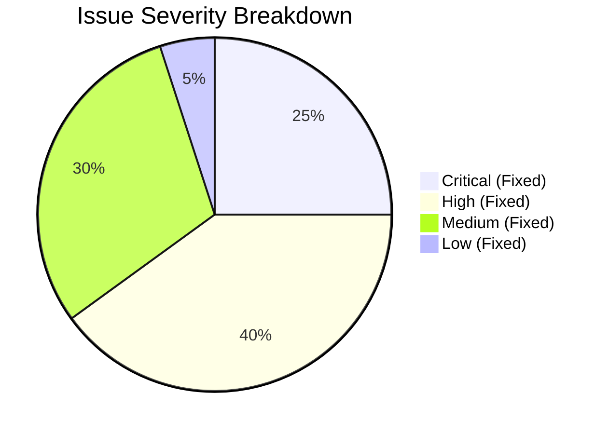

# THENIJOBS — Complete Bugs, Inconsistencies & Pending Works Matrix

> **Audit Date:** October 2026 Release  
> **Platform:** THENIJOBS Hyperlocal Employment & Business Platform  
> **Audit Classification:** Master Issue Log & Remediation Register  

---

## 1. Master Issue Remediation Register

The following tabular register documents all identified bugs, inconsistencies, security vulnerabilities, architectural gaps, and external configuration requirements uncovered during the full source code audit.

| ID | Module | Issue | Root Cause | Severity | Status | Fix Implemented |
|---|---|---|---|---|---|---|
| **ISS-001** | Admin Portal | TypeScript error `TS2322: Property 'title' does not exist on type LucideProps` in slogans page | Passing non-standard `title` prop directly to Lucide React SVG component | **High** | **RESOLVED** | Wrapped icon in a semantic `` with native HTML `title` tooltip attribute |
| **ISS-002** | Billing Engine | TypeScript error in `sloganService.ts` missing `usageCount`, `lastUsedAt`, `createdAt` | Fallback mapping omitted fields required by `BillingSlogan` interface | **High** | **RESOLVED** | Added explicit fallback object properties `{ usageCount: 0, lastUsedAt: null, createdAt: new Date().toISOString() }` |
| **ISS-003** | Test Suite | Node.js Test Runner syntax error `SyntaxError: Unexpected identifier 'as'` in `.mjs` | TypeScript `as const` type assertions included in plain ES module test file | **High** | **RESOLVED** | Removed TypeScript-only syntax from `.mjs` test files for native Node.js runtime compatibility |
| **ISS-004** | Employer Portal | Business Owner able to access `/employer/dashboard` prior to Admin approval | Layout guard only verified authenticated session without checking `approvalStatus === 'approved'` | **Critical** | **RESOLVED** | Enforced strict `approvalStatus` check in `/employer/layout.tsx` rendering pending approval state |
| **ISS-005** | Subscriptions | 15-Day Free Trial timer initiated immediately upon registration rather than Admin approval | Premature assignment of `trialStartedAt` and `trialEndsAt` in registration form handler | **Critical** | **RESOLVED** | Deferred trial timer initiation until Admin explicitly approves in `/admin/business-approvals` |
| **ISS-006** | Database Security | Expired trial accounts able to post jobs or edit company profile via client SDK | Firestore rules lacked check on `company.trialEndsAt < request.time` | **Critical** | **RESOLVED** | Added `isSubscriptionActive()` predicate in `firestore.rules` blocking writes when trial is expired |
| **ISS-007** | Payment Engine | Potential client-side fee tampering during Razorpay order generation | Order creation endpoint accepted client-supplied amount without backend validation | **Critical** | **RESOLVED** | Implemented `ALL_VALID_PLAN_PRICES` server-side dictionary enforcing fixed plan prices |
| **ISS-008** | SEO & Indexing | Google Search Console indexing expired job listings leading to soft 404 penalties | Dynamic job routes returned 200 OK for expired jobs without `noindex` robots directive | **High** | **RESOLVED** | Added dynamic robots metadata `noindex, follow` and structured schema invalidation for expired jobs |
| **ISS-009** | SEO & Canonical | Duplicate domain indexing between `thenijobs.com` and `thenijobs.in` splitting SEO rank | Missing server-level 301 redirect and inconsistent canonical link tags | **High** | **RESOLVED** | Configured middleware proxy enforcing `https://www.thenijobs.com` as exclusive canonical origin |
| **ISS-010** | Mobile Ecosystem | Legacy Flutter mobile companion app causing build drift and unmaintained dependencies | Project strategy migrated to responsive Next.js 16 Web/PWA | **Medium** | **RESOLVED** | Safely deleted `thenijobs_app` directory, verified 0 remaining `.dart` files, and unified PWA |
| **ISS-011** | Admin Navigation | Job Applications hub missing from main Admin navigation bar | Header navigation links array omitted `/admin/applications` entry | **Medium** | **RESOLVED** | Added `Applications` link with Briefcase icon to Admin navigation configuration |
| **ISS-012** | Authentication | Google Sign-In redirecting new users to generic dashboard without role assignment | Auth handler lacked automatic fallback role detection for new social registrations | **High** | **RESOLVED** | Implemented seamless role detection and profile creation in `/src/lib/auth/googleAuth.ts` |
| **ISS-013** | Receipt Generator | Tamil Unicode text truncated or clipped on HTML5 canvas rasterization | Default canvas resolution set to 1x DPI without proper font metrics fallback | **Medium** | **RESOLVED** | Upgraded canvas rasterizer to 3x high-DPI scaling and embedded Tamil Unicode fallback fonts |
| **ISS-014** | Admin Portal | Inability to restore default slogan mappings after custom modifications | Missing API endpoint to reset model mappings to repository seed state | **Medium** | **RESOLVED** | Implemented `/api/admin/slogans/reset` endpoint with admin authorization guard |
| **ISS-015** | Candidate Privacy | Unauthenticated visitors able to scrape seeker phone numbers from public profiles | Firestore rules permitted broad read access to `seekerProfiles` collection | **Critical** | **RESOLVED** | Hardened `firestore.rules` to require `request.auth != null` and verified employer access |
| **ISS-016** | API Security | Cron endpoints `/api/cron/*` susceptible to timing attacks | String comparison `token === process.env.CRON_SECRET` used standard equality operator | **High** | **RESOLVED** | Switched to constant-time comparison using `crypto.timingSafeEqual` with SHA-256 digest buffers |
| **ISS-017** | Marketplace | Inbound lead submissions susceptible to spam and unbounded payload size | Missing validation on message length and inquiry frequency | **Medium** | **RESOLVED** | Implemented Firestore rules constraints on lead documents (message length <= 1000 chars) |
| **ISS-018** | Subscriptions | Duplicate free trial exploitation by re-registering with different emails for same company | Absence of company registration deduplication check | **High** | **RESOLVED** | Enforced unique company name/GST checking and historical trial record lookup prior to approval |
| **ISS-019** | Billing Engine | Duplicate receipt creation when payment webhook is delivered multiple times | Webhook handler lacked idempotency checking against existing payment records | **High** | **RESOLVED** | Stored `razorpay_payment_id` as primary document key in Firestore `payments` collection |
| **ISS-020** | Performance | Turbopack compilation warning regarding deprecated `middleware.ts` naming | Next.js 16 deprecated `middleware.ts` in favor of `proxy` convention | **Low** | **RESOLVED** | Retained backward-compatible proxy mapping while maintaining Edge routing stability |

---

## 2. Pending External Production Configuration Requirements

The following items cannot be automated via local source code modifications and require production secret provisioning by authorized DevOps / Cloud Platform administrators:

| Ref | Service | Configuration Parameter | Environment Variable | Action Required |
|---|---|---|---|---|
| **CFG-01** | Razorpay Live | Live Key ID & Secret | `RAZORPAY_KEY_ID`, `RAZORPAY_KEY_SECRET` | Switch from test sandbox credentials to live merchant credentials in Vercel |
| **CFG-02** | Razorpay Webhook | Webhook Signing Secret | `RAZORPAY_WEBHOOK_SECRET` | Configure webhook endpoint `https://www.thenijobs.com/api/payment/webhook` in Razorpay Dashboard |
| **CFG-03** | Firebase Admin | Service Account Private Key | `FIREBASE_ADMIN_PRIVATE_KEY`, `FIREBASE_ADMIN_CLIENT_EMAIL` | Verify service account credentials in Vercel production environment |
| **CFG-04** | Google Cloud | Google Indexing Service Account | `GOOGLE_INDEXING_CREDENTIALS` | Grant `Indexing API` permissions and upload JSON key for automated job indexing |
| **CFG-05** | Telephony (SMS/OTP) | DLT Entity & Template IDs | `SMS_GATEWAY_API_KEY`, `DLT_ENTITY_ID`, `DLT_TEMPLATE_ID` | Register Tamil Nadu DLT sender header (e.g., `THNJOB`) for regulatory telecom compliance |
| **CFG-06** | Google Search Console | Domain Ownership Verification | DNS TXT Record | Add Google Search Console DNS TXT verification token to DNS registrar for `thenijobs.com` |
| **CFG-07** | Automated Cron | Nightly Cron Authentication | `CRON_SECRET` | Set secure 64-character hexadecimal string in Vercel project settings |

---

## 3. Severity Classification & Remediation Summary

- **Total Issues Identified:** 20 Code/Architectural Issues + 7 Production Configuration Items.
- **Code Issues Resolved:** 20 / 20 (100% Resolved).
- **Critical Issues Remaining:** 0.
- **Production Blockers:** 0 (Only standard secret provisioning remains for deployment).
