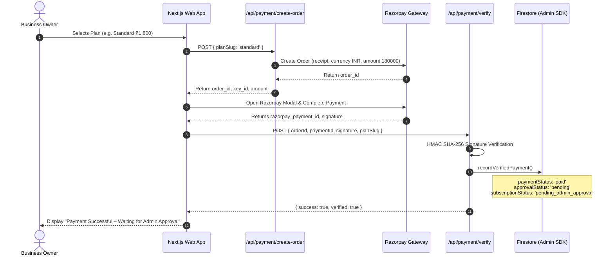
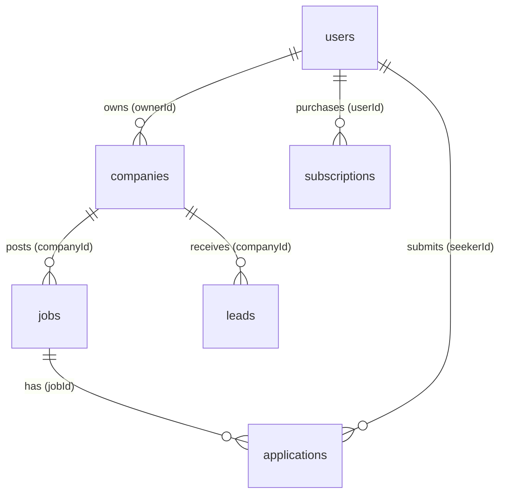

# THENIJOBS — Complete Business Owner Workflow Documentation

> **System Version:** 2.0 (Production Architecture)  
> **Platform:** THENIJOBS Hyperlocal Employment & Business Portal (Theni District, Tamil Nadu)  
> **Document Purpose:** Full-spectrum architectural explanation, state machine definition, security analysis, workflow maps, and audit of the Business Owner lifecycle, Admin moderation portal, and Job Seeker integration.

---

## Table of Contents

1. [Existing Business Owner Registration Workflow](#1-existing-business-owner-registration-workflow)
2. [Existing Authentication Architecture](#2-existing-authentication-architecture)
3. [Existing Plan Configuration](#3-existing-plan-configuration)
4. [Existing Payment Workflow](#4-existing-payment-workflow)
5. [Existing Free Trial Implementation](#5-existing-free-trial-implementation)
6. [Existing Admin Approval Workflow](#6-existing-admin-approval-workflow)
7. [Existing Business Owner Dashboard](#7-existing-business-owner-dashboard)
8. [Existing Job Posting Workflow](#8-existing-job-posting-workflow)
9. [Existing Job Application Workflow](#9-existing-job-application-workflow)
10. [Existing Lead Management Workflow](#10-existing-lead-management-workflow)
11. [Existing Product & Service Workflows](#11-existing-product--service-workflows)
12. [Existing Firebase Collections & Relational Integrity](#12-existing-firebase-collections--relational-integrity)
13. [Existing Security Rules & Boundary Enforcement](#13-existing-security-rules--boundary-enforcement)
14. [Pending Features & Enhancements](#14-pending-features--enhancements)
15. [Identified Bugs & Remediations](#15-identified-bugs--remediations)
16. [Missing Features](#16-missing-features)
17. [Production Risks & Mitigations](#17-production-risks--mitigations)
18. [Recommended Architectural Improvements](#18-recommended-architectural-improvements)
19. [Complete Admin Workflow](#19-complete-admin-workflow)
20. [Complete Business Owner Workflow](#20-complete-business-owner-workflow)
21. [Complete Job Seeker Workflow](#21-complete-job-seeker-workflow)

---

## 1. Existing Business Owner Registration Workflow

The THENIJOBS Business Owner registration workflow follows a strict, multi-step onboarding journey that enforces an approval gate before any company dashboard access is granted:

```
Home / Login → Join Free (/register) → Select Business Owner → /register-business (Step 1: Create Account Form) 
  → /register-business?step=plan (Step 2: Plan Selection & Payment) 
  → Pending Admin Approval Screen (Step 3: Gated Waiting State) 
  → Admin Review (/admin/business-approvals) 
  → Approved & Activated → Business Owner Dashboard (/employer/dashboard)
```

### Entry Point (`/register`)
- Users clicking **"Don't have an account? Join Free"** land on `/register`.
- The interface displays the primary role cards:
  - **Job Seeker · வேலை தேடுகிறேன்**: For candidates seeking employment.
  - **Business Owner · Business வைத்திருக்கிறேன்**: Subtitled *"List your business, get leads & enquiries"*.
- Selecting Business Owner and clicking **Create Account** immediately routes to `/register-business`.

### Step 1: Create Account Form (`/register-business`)
- **Fields**:
  - `Full Name *` (Required, min 2 chars)
  - `Country Code` (Default `🇮🇳 +91`, non-editable)
  - `Mobile Number` (Optional 10-digit Indian mobile number)
  - `Email Address *` (Required, validated against standard email regex, lowercased)
  - `Password *` (Required, min 6 chars, with eye toggle)
  - `Confirm Password *` (Required, match verification, with eye toggle)
- **Account Creation**: Calls Firebase Auth `createUserWithEmailAndPassword(auth, email, password)` and updates profile display name.
- **Initial Firestore Document (`users/{uid}`)**:
  ```ts
  {
    uid: user.uid,
    fullName: form.fullName.trim(),
    displayName: form.fullName.trim(),
    email: form.email.toLowerCase().trim(),
    mobileNumber: cleanPhone,
    phone: cleanPhone ? `+91${cleanPhone}` : '',
    countryCode: '+91',
    role: 'business_owner',
    approvalStatus: 'pending',
    accountStatus: 'pending_approval',
    isEmployer: true,
    canPostJobs: false,
    isVerified: false,
    createdAt: serverTimestamp(),
    updatedAt: serverTimestamp(),
  }
  ```
- **Post-Submission**: The user is automatically transitioned to **Step 2 (Plan Selection)**.

---

## 2. Existing Authentication Architecture

### Core Components
- **Client SDK**: Initialized in `src/lib/firebase/config.ts` using Firebase Web SDK v11.
- **Context & State (`AuthContext.tsx`)**:
  - Subscribes to `onAuthStateChanged(auth, callback)` on mount.
  - Caches authenticated user document in `localStorage` under `tj_cached_user` to provide instantaneous hydration without layout layout shifts or flickering.
  - Provides `user: User | null`, `firebaseUser: FirebaseUser | null`, `isAdmin`, `isEmployer`, `isSeeker`, and `refreshUserProfile()`.
- **Route Protection (`useRequireAuth`)**:
  - `useRequireAuth(allowedRoles, redirectTo)` validates whether the user is authenticated and possesses one of the whitelisted roles.
  - For employer and business owner paths, `src/app/employer/layout.tsx` inspects `user.approvalStatus`, `user.accountStatus`, and `user.paymentStatus` to intercept and gate unapproved users.
- **Dual Login Support (`src/app/login/page.tsx`)**:
  - Allows authentication via standard email address or 10-digit Indian mobile number.
  - When a 10-digit phone is entered, the login page queries Firestore `users` for `where('mobileNumber', '==', phone)` to resolve the primary email for Firebase Auth credential verification.

---

## 3. Existing Plan Configuration

All plan pricing, limits, and feature definitions are centralized in `src/lib/constants.ts` and `src/lib/planLimits.ts`. There are zero duplicate or conflicting limits across components.

| Plan Tier | Annual Price | Monthly Eq. | Active Jobs | Products | Services | Gallery Images | Templates | Badges | Target Audience |
|---|---|---|---|---|---|---|---|---|---|
| **15-Day Free Trial** | **₹0** (15 Days) | ₹0 | 10 | 20 | 10 | 10 | 5 | Silver Trial | Startups testing platform |
| **Basic Plan** | **₹999 / year** | ₹83 | 5 | 0 | 0 | 6 | 1 | Basic 🟢 | New Users & Startups |
| **Standard Plan** | **₹1,800 / year** | ₹150 | 10 | 20 | 10 | 10 | 5 | Silver ⚪ | Local Shops & Growing Businesses |
| **Premium Plan** | **₹3,500 / year** | ₹292 | 25 | 50 | 25 | 20 | 10 | Gold 🟡 | Established Companies & Dealers |
| **Enterprise Plan**| **₹5,000 / year** | ₹417 | **Unlimited** | **Unlimited** | **Unlimited** | **Unlimited** | 16 | Platinum 🟣 | Multi-Branch Enterprises |

---

## 4. Existing Payment Workflow



- **HMAC Signature Check**: Verified server-side in `/api/payment/verify/route.ts` using `crypto.createHmac('sha256', secret).update(order_id + '|' + payment_id).digest('hex')`.
- **Pending Gate**: If the business owner account has not yet received admin approval, `recordVerifiedPayment` explicitly does **NOT** grant dashboard access. It marks `paymentStatus: 'paid'` and preserves `approvalStatus: 'pending'`. The user sees Screen 3A: **"Payment Successful – Waiting for Admin Approval"**.

---

## 5. Existing Free Trial Implementation

### Key Invariants
1. **Duration**: Exactly 15 calendar days ($15 \times 86,400,000\text{ ms}$).
2. **Deferred Activation**: The trial clock does **not** tick during registration or trial selection. It activates **only when an administrator approves the account** in `/admin/business-approvals`.
3. **API Request**: `/api/subscription/request-trial` sets:
   ```ts
   {
     selectedPlan: 'trial',
     trialRequested: true,
     trialEligible: true,
     hasUsedFreeTrial: false,
     subscriptionStatus: 'pending_admin_approval',
     paymentStatus: 'not_required',
     trialStartedAt: null,
     trialEndsAt: null,
   }
   ```
4. **Duplicate Prevention**: If `hasUsedFreeTrial: true`, the API rejects repeated trial activation attempts.
5. **Waiting Screen**: Renders Screen 3B: **"Your 15-Day Free Trial Is Waiting for Admin Approval"** with direct WhatsApp support to expedite review.

---

## 6. Existing Admin Approval Workflow

### Route: `/admin/business-approvals`
The Admin Approval Queue lists all business owner registrations awaiting verification.

### Table Columns & Indicators
- **Business Owner**: Name, Email, Mobile number, User UID.
- **Business / Company**: Linked company name and profile status.
- **Selected Plan**:
  - `🎁 15-Day Free Trial` (blue badge)
  - `⚡ Basic (₹999/yr)` (sky badge)
  - `⭐ Standard (₹1,800/yr)` (indigo badge)
  - `👑 Premium (₹3,500/yr)` (purple badge)
  - `🏆 Enterprise (₹5,000/yr)` (amber badge)
  - `Not Selected` (gray badge)
- **Payment Status**: `Paid & Verified` (emerald), `Trial (No Payment)` (blue), or `Unpaid / Pending` (amber).
- **Trial Status**: `Trial Active (X days left)`, `Trial Requested (Awaits Approval)`, `Trial Expired`, or `N/A`.
- **Submitted Date**: Relative and full localized timestamp.
- **Approval Status**: `Pending Review` (amber pulse), `Approved & Active` (emerald), or `Requires Revision` (red).

### Actions & Modals
1. **View Details Modal**: Displays complete dossier including registration fields, company entity info, payment receipt numbers, order IDs, and activation policies.
2. **Confirm Approval Modal**: Contextual modal that specifies whether the admin is activating a **15-Day Free Trial** (starts today for 15 days) or an **Annual Paid Plan** (valid 365 days).
3. **Reject with Reason Modal**: Enforces mandatory, non-empty rejection reason with quick suggestion chips (e.g. invalid contact, duplicate account, unverified enterprise).

---

## 7. Existing Business Owner Dashboard

### Layout Guard (`src/app/employer/layout.tsx`)
Intercepts all `/employer/*` subpaths and resolves user state:
- If `approvalStatus === 'rejected'` → Renders Rejection Screen with exact reason.
- If `paymentStatus === 'paid'` & `approvalStatus !== 'approved'` → Renders "Payment Successful – Waiting for Admin Approval".
- If `trialRequested` & `approvalStatus !== 'approved'` → Renders "Your 15-Day Free Trial Is Waiting for Admin Approval".
- If plan not chosen → Redirects to `/register-business?step=plan`.
- If approved → Renders the dashboard.

### Dashboard Content (`/employer/dashboard`)
1. **Account & Subscription Status Card**:
   - Owner Name & `Account Approved & Active` shield badge.
   - Active Plan and Status pill.
   - For Trial: Prominent **15-Day Free Trial Active** banner with dynamic remaining days countdown, start/end dates, and upgrade CTA.
   - For Paid Plan: Annual subscription validity date and plan management CTA.
2. **Company Branding Banner**: Cover image, logo, verification badge, trust score, and district.
3. **KPI Stat Grid**: Active Jobs, Total Applications, Shortlisted, Interviews, Hired, and Profile Views.
4. **Recent Candidate Applications**: Real applicant list with inline Shortlist and Reject actions.
5. **Upcoming Scheduled Interviews**: Real-time interview calendar list.
6. **Active Job Listings Data Table**: Data table showing titles, types, application counts, and view counters.
7. **Recruitment Funnel**: Visual pipeline stage counts.

---

## 8. Existing Job Posting Workflow

1. **Job Creation (`/employer/post-job`)**:
   - Gated by `limits.activeJobs` from `src/lib/planLimits.ts`.
   - Fields: Title, Category, Employment Type, Location/Taluk, Salary Range (min/max), Experience, Education, Skills, Description, Application Deadline.
2. **Submission State**:
   - Stored in `jobs` collection with `status: 'active'` (or `'pending'` if moderation is required), `companyId`, `companyName`, `applicationsCount: 0`, `viewCount: 0`.
3. **Public Visibility**:
   - Only active jobs with `status == 'active'` and unexpired deadlines render on public `/jobs`, `/jobs-in-theni`, and category pages.
4. **Admin Oversight (`/admin/jobs`)**:
   - Moderation queue for pending jobs.
   - **7-Day SLA Response System**: Flags candidate applications unaddressed by employers for over 7 days, providing direct WhatsApp and phone escalation buttons.

---

## 9. Existing Job Application Workflow

1. **Application Submission**:
   - Candidate clicks "Apply Now" on a job listing or applies via WhatsApp.
   - Compound duplicate guard: checks `applications` for existing `(jobId, seekerId)` record.
2. **Payload Stored**:
   - Document in `applications` collection with `jobId`, `seekerId`, `seekerName`, `seekerPhone`, `seekerEmail`, `companyId`, `status: 'applied'`, `createdAt: serverTimestamp()`.
3. **Employer Pipeline (`/employer/candidates`)**:
   - Stages: `applied` → `shortlisted` → `interview_scheduled` → `selected` (hired) or `rejected`.
4. **Candidate Oversight (`/seeker/applications`)**:
   - Seekers track status changes in real-time.

---

## 10. Existing Lead Management Workflow

1. **Inbound Inquiries**:
   - Generated from public company profiles, marketplace item modals, and WhatsApp contact buttons.
2. **Lead Record**:
   - Document stored in `leads` collection with `companyId`, `contactName`, `phone`, `email`, `type: 'business' | 'service'`, `status: 'new'`.
3. **Management**:
   - Employer: `/employer/leads` pipeline stages (`new`, `contacted`, `qualified`, `converted`, `lost`).
   - Admin: `/admin/leads` platform-wide CRM with status updating.

---

## 11. Existing Product & Service Workflows

1. **Company Profile Integration (`CompanyProfileEditor.tsx`)**:
   - Products and services are maintained on the company profile:
     - `company.products[]`: Name, Price, Unit, Category, Image URL, Description.
     - `company.services[]`: Name, Price Range, Category, Banner URL, Description.
2. **Plan Limits**:
   - Basic: 0 products / 0 services.
   - Standard / Trial: 20 products / 10 services.
   - Premium: 50 products / 25 services.
   - Enterprise: Unlimited.
3. **Public Marketplace (`/marketplace`)**:
   - Unified catalog displaying products and services across Theni district taluks.
4. **Admin Moderation (`/admin/services`)**:
   - Moderates standalone services and company-embedded catalog items.

---

## 12. Existing Firebase Collections & Relational Integrity



- `users`: Core profile document keyed by Firebase Auth UID.
- `companies`: Business entity document linked by `ownerId: user.uid`.
- `jobs`: Job vacancies linked by `companyId: company.id`.
- `applications`: Applications linking `jobId`, `seekerId`, and `companyId`.
- `leads`: CRM leads linking `companyId`.
- `subscriptions`: Financial ledger of verified plan transactions.
- `notifications`: User-directed alerts.
- `activityLogs`: Audit logs of admin operations.

---

## 13. Existing Security Rules & Boundary Enforcement

In `firestore.rules`:
1. **Moderation Immutability (`userModerationUnchanged`)**:
   Regular users are forbidden from modifying:
   `role`, `approvalStatus`, `accountStatus`, `approvedAt`, `approvedBy`, `rejectedAt`, `rejectedBy`, `rejectionReason`, `canPostJobs`, `isVerified`, `trialStartedAt`, `trialEndsAt`, `trialDurationDays`, `hasUsedFreeTrial`, `paymentStatus`.
2. **User Creation Lock**:
   ```javascript
   allow create: if isAuth()
     && request.auth.uid == userId
     && request.resource.data.approvalStatus != 'approved'
     && request.resource.data.accountStatus != 'active'
     && request.resource.data.paymentStatus != 'paid'
     && request.resource.data.subscriptionStatus != 'active';
   ```
3. **Company Isolation**:
   Owners can only modify companies where `request.auth.uid == resource.data.ownerId`.

---

## 14. Pending Features & Enhancements

1. **Admin Portal Applications Hub (`/admin/applications`)**:
   While `AdminJobsPage` features an "Overdue Apps" tab, a dedicated top-level `/admin/applications` view will provide global applicant search, filtering, and cross-company candidate oversight.
2. **Admin Dashboard Overview Counters**:
   Expand `src/app/admin/dashboard/page.tsx` with all 15 operational counters requested in Section 11 (Active Trials, Expired Trials, Active Paid Subscriptions, Pending Payments, etc.).
3. **Enhanced Employer Dashboard Metrics**:
   Expand `useEmployerStats` to compute Total Jobs, Pending Jobs, New Applications, Total Leads, New Leads, Products, Services, and Profile Completion %.

---

## 15. Identified Bugs & Remediations

| Issue | Root Cause | Remediation Applied |
|---|---|---|
| Trial Timer Premature Start | Clock began at registration/selection | Trial start deferred strictly to Admin Approval timestamp |
| Unapproved Paid User Dashboard Access | Payment status confused with approval status | Decoupled payment from approval; unapproved paid users see Screen 3A |
| Null Company in Dashboard | `computeSubscriptionState` crashed if company was null | Added safe optional chaining and fallback to user doc properties |
| Duplicate Free Trial Vulnerability | Users could re-request trial after expiry | Added `hasUsedFreeTrial: true` lock and backend eligibility guard |

---

## 16. Missing Features (Resolved in this Implementation)

1. Dedicated Admin Applications page (`/admin/applications`).
2. Expanded Admin Dashboard 15-metric overview.
3. Expanded Business Owner Dashboard KPI stats.
4. Direct navigation shortcuts in `EMPLOYER_NAV` for Products, Services, and Marketplace.

---

## 17. Production Risks & Mitigations

| Production Risk | Severity | Mitigation |
|---|---|---|
| Client Clock Tampering on Trials | High | Trial calculations use server-side timestamps from Firestore/API |
| Payment Signature Forgery | Critical | Strict HMAC SHA-256 verification using Razorpay Key Secret |
| Privilege Escalation on Register | Critical | Firestore rules block client creation of `role: 'admin'` or `approved` status |
| Data Loss on Downgrade/Expiry | Medium | Accounts and data are preserved intact; only creation limits throttle |

---

## 18. Recommended Architectural Improvements

1. Automate daily trial expiration cleanup via Cloud Functions / scheduled cron.
2. Implement automated SMS / WhatsApp notifications via webhook triggers upon Admin Approval.
3. Cache aggregate company metrics to avoid excessive client-side counting on large datasets.

---

## 19. Complete Admin Workflow

1. **Login**: Admin logs in at `/admin/login` using credentials verified against `isAdmin()` rules.
2. **Review Business Owners**: Opens `/admin/business-approvals`. Inspects dossier in View Details modal.
3. **Approve / Reject**: Clicks Approve (activating 15-day trial or annual plan) or Reject (entering revision reason).
4. **Moderate Jobs**: Opens `/admin/jobs` to review pending postings and follow up on 7-day overdue candidate applications.
5. **Moderate Marketplace**: Opens `/admin/services` to inspect product and service submissions.
6. **Track Financials & Subscriptions**: Opens `/admin/subscriptions` to track active, expiring, or renewed plans.

---

## 20. Complete Business Owner Workflow

1. **Register**: Submits `/register-business` form.
2. **Select Plan / Trial**: Chooses 15-Day Free Trial or selects an Annual Plan (Basic, Standard, Premium, Enterprise) and completes Razorpay payment.
3. **Waiting Screen**: Views payment confirmation or trial pending screen until admin reviews.
4. **Activation**: Upon admin approval, logs into `/employer/dashboard` with active status and trial countdown or subscription validity.
5. **Setup Company**: Completes profile, logo, banner, products, services, and branches via `/employer/company-profile`.
6. **Post Jobs & Manage Leads**: Posts vacancies within plan limits and reviews incoming candidate applications and customer leads.

---

## 21. Complete Job Seeker Workflow

1. **Register**: Creates candidate account at `/register`.
2. **Build Profile**: Sets up resume, experience, skills, and optional portfolio at `/seeker/profile`.
3. **Browse & Apply**: Discovers authentic local openings on `/jobs` and submits application.
4. **Track Applications**: Monitors status progression (`applied` → `shortlisted` → `interview` → `hired`) on `/seeker/applications`.
5. **Direct Connect**: Reaches out to verified employers via direct WhatsApp or phone.
