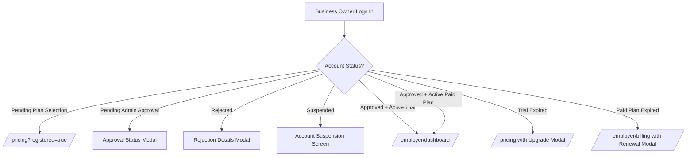

# THENIJOBS — Complete Features & Workflows Specification

**Version:** 1.0.0 Production  
**Platform:** THENIJOBS Hyperlocal Job & Marketplace Portal  
**Scope:** Public, Seeker, Business Owner (Employer), and Administrator Portals

---

## 1. Dual-Role Registration & Authentication Workflow

### 1.1 Role Selection Matrix
- When visiting `/register`, users are presented with two options:
  1. **Job Seeker (`வேலை தேடுகிறேன்`)**: Instant access to candidate dashboard, resume builder, job alerts, and one-click applications.
  2. **Business Owner (`Business வைத்திருக்கிறேன்`)**: Multi-step business setup including plan selection, admin verification, job posting, applicant pipeline, and company portal.

### 1.2 Form Fields & Security Controls
| Field | Requirement | Validation Rules |
| :--- | :--- | :--- |
| **Full Name** | Mandatory | 2–80 characters, sanitized string. |
| **Mobile Number** | Mandatory | 10-digit Indian number, normalized to E.164 (`+91XXXXXXXXXX`). |
| **Email** | Mandatory | Valid RFC 5322 email syntax. |
| **Password** | Mandatory | Minimum 6 characters; validated against Firebase Auth. |
| **Confirm Password** | Mandatory | Must match password exactly. Show/hide toggle provided. |

### 1.3 Post-Registration State Engine
- **Job Seeker**:
  1. Firebase user created.
  2. Firestore `users/{uid}` created with `role: 'job_seeker'`.
  3. `seekerProfiles/{uid}` document initialized.
  4. Instant redirect to `/seeker/dashboard`.
- **Business Owner**:
  1. Firebase user created.
  2. Firestore `users/{uid}` created with `role: 'business_owner'`, `accountStatus: 'pending_admin_approval'`, `subscriptionStatus: 'pending_plan_selection'`.
  3. Redirects to `/pricing?registered=true&role=business_owner`.

---

## 2. Subscription, Free Trial & Pricing Architecture

### 2.1 The 4 Authoritative Subscription Plans
1. **Free / Starter (`₹0`)**: 1 active job, basic directory listing.
2. **Basic (`₹2,499/yr`)**: 5 active jobs, candidate management, verified profile badge.
3. **Standard (`₹4,999/yr`)**: 10 active jobs, 5 website templates, digital business ID, applicant ATS.
4. **Premium / Enterprise (`₹9,999/yr`)**: Unlimited active jobs, 16 website templates, AI job description & resume scoring, dedicated account manager.

### 2.2 15-Day Free Trial Rules & Mechanics
- **Tier:** Grants Standard Plan privileges (10 active jobs, 5 website templates, digital ID).
- **Duration:** Exactly 15 calendar days from the moment of Admin Approval.
- **Backend Timestamp Enforcement:**
  - Client sends request to `/api/subscription/request-trial`.
  - Server verifies user identity, role, and prior trial eligibility.
  - Server sets `trialRequested: true`, `subscriptionStatus: 'trial_pending_approval'`.
  - **No dates are set by client.**
- **Activation upon Admin Approval:**
  - When Admin clicks "Approve & Verify Business Owner", `verifyUser()` sets:
    - `approvalStatus: 'approved'`
    - `accountStatus: 'active'`
    - `trialStartDate: serverTimestamp()`
    - `trialEndDate: serverTimestamp() + 15 days`
    - `subscriptionPlan: 'standard'`
    - `subscriptionStatus: 'trial'`
- **Dashboard Access:** Active trial business owners have full access to `/employer/dashboard`, `/employer/jobs`, `/employer/post-job`, `/employer/candidates`, `/employer/leads`, and `/employer/company-profile`.
- **Automatic Expiry:**
  - Calculated on each page request via `resolveSubscriptionState()`.
  - Reconciled globally by `/api/cron/expire-trials`.
  - Expired accounts transition to `trial_expired` and redirect to `/pricing`.
  - **Zero data loss:** Company profile, posted jobs, received applications, and customer leads remain preserved in Firestore.

---

## 3. Business Owner Status-Based Navigation

---

## 4. Admin Portal & Moderation Workflows

### 4.1 Business Owner Moderation
- **Location:** `/admin/users` & `/admin/business-approvals`
- **Actions:**
  - **Approve & Verify**: Invokes `verifyUser()`. Automatically starts the 15-day trial if requested, or activates verified status. Sends in-app notification.
  - **Reject**: Invokes `rejectUser()` requiring an explicit rejection rationale. Sends in-app notification.
  - **Suspend / Reactivate**: Enables administrative governance for terms-of-service violations.

### 4.2 Job & Marketplace Moderation
- **Jobs:** Moderation statuses include `draft`, `pending`, `published`, `closed`, and `expired`.
- **Products & Services:** Business owners create products and services under their company. Only approved items are visible on the public `/marketplace` and `/marketplace?type=services`.

---

## 5. Daily Jobs & Seeker Workflow

### 5.1 Job Discovery & Hyperlocal Filtering
- Search across job title, company name, skills, and taluk (`Theni`, `Periyakulam`, `Bodinayakanur`, `Cumbum`, `Uthamapalayam`, `Andipatti`, `Chinnamanur`).
- Direct WhatsApp quick-apply pre-fills job title and canonical job URL.

### 5.2 Application Integrity
- Compound index on `(jobId, seekerId)` prevents duplicate applications.
- Job applications are stored in Firestore under `/applications/{id}` with complete seeker details, resume URL, status history (`pending`, `reviewed`, `interview`, `accepted`, `rejected`), and timestamps.
- Business owners review applications in `/employer/candidates`.
