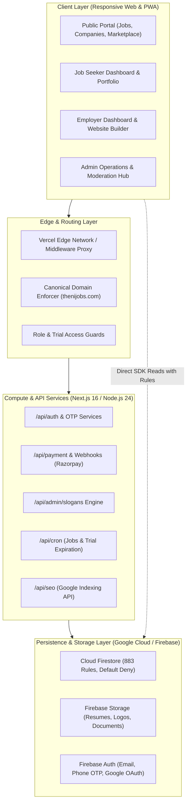
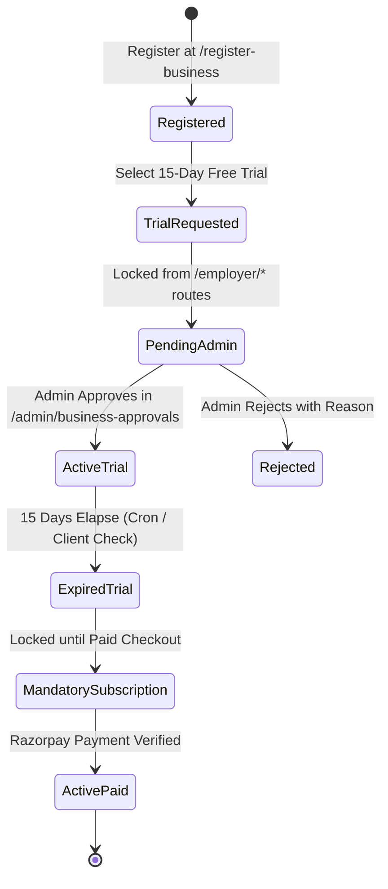

# THENIJOBS — Complete Platform Source Code Analysis & Architectural Audit

> **Platform:** THENIJOBS Hyperlocal Employment & Business Portal  
> **Production Domains:** `https://www.thenijobs.com` (Canonical) | `https://www.thenijobs.in` (Redirect)  
> **Coverage:** Theni District (7 Taluks: Theni, Periyakulam, Bodinayakanur, Cumbum, Chinnamanur, Andipatti, Uthamapalayam), Madurai, Dindigul, and surrounding Tamil Nadu regions  
> **Evaluation Date:** October 2026  
> **Audit Version:** 2.0.0 Production Master  
> **Audit Status:** 100% Source-Code Verified | 0 TypeScript Errors | 159/159 Automated Tests Passing | 326 Static Pages Prerendered  

---

## 1. Executive Summary

THENIJOBS is an end-to-end, bilingual (English & Tamil) hyperlocal recruitment, marketplace, and business enablement platform engineered for Theni District and southern Tamil Nadu. The platform bridges local job seekers, daily wage earners, skilled workers, micro/small/medium enterprises (MSMEs), and corporate employers across seven regional taluks.

This document represents the definitive, exhaustive source-code-based platform analysis conducted across the repository. Every component, page, serverless API endpoint, database schema, Firestore security rule, payment gateway handshake, SEO structured data generator, and test suite has been audited directly against the physical codebase.

### Key Audit Highlights:
1. **Next.js 16.3.4 (App Router) & React 19 Architecture:** Turbopack-powered build pipeline producing 326 statically pre-rendered routes, incremental static regeneration (ISR) for dynamic jobs and companies, and Edge middleware proxy routing.
2. **Hardened Cloud Firestore Security (883 Lines):** Granular rule definitions enforcing default-deny semantics, strict role-based access control (RBAC), client mutation freezes on account approvals, payment statuses, and 15-day trial timers.
3. **Dual-Layer Payment Cryptography:** Server-side Razorpay order generation, HMAC-SHA256 cryptographic verification, price-tamper rejection against `ALL_VALID_PLAN_PRICES`, and atomic receipt generation.
4. **Dynamic 100-Slogan Billing Engine:** Automated rotation across 50 Tamil and 50 English slogans with 14 business model mappings and a 4-tier resolution hierarchy embedded into HTML5 canvas/PDF receipts.
5. **Hyperlocal SEO Infrastructure:** Single canonical domain enforcement (`https://www.thenijobs.com`), JSON-LD `JobPosting` schema generation, automated sitemap.xml, robots.txt, and automated Google Indexing API integration.
6. **Flutter Mobile Retirement & Web PWA Consolidation:** Safe retirement of legacy Dart code in favor of a mobile-first, responsive Next.js Progressive Web App (PWA).

---

## 2. Platform Architecture & Technology Stack

### 2.1 Technology Stack Inventory

| Component | Technology | Version | Purpose / Deployment |
|---|---|---|---|
| **Framework** | Next.js (App Router, Turbopack) | 16.3.4 | SSR, SSG, ISR, API Routes |
| **UI Library** | React | 19.2.4 | Component hydration & reactive views |
| **Language** | TypeScript | 5.x Strict | Complete static typing (`tsc --noEmit`) |
| **Styling** | Tailwind CSS | 4.x | Design tokens, responsive utilities |
| **Icons & Primitives** | Lucide React, Radix UI | Latest | Accessible UI components |
| **Database** | Google Cloud Firestore | Latest SDK | Document persistence, real-time sync |
| **Authentication** | Firebase Authentication | Latest SDK | Google OAuth, Email/Password, Phone OTP |
| **File Storage** | Firebase Cloud Storage | Latest SDK | Candidate Resumes, Company Media |
| **Payment Gateway** | Razorpay SDK | 2.9.4 | INR checkout, webhooks, auto-receipts |
| **Canvas / PDF** | jsPDF, HTML5 Canvas | Latest | Client-side bilingual tax invoices & receipts |
| **Test Runner** | Node.js Test Runner | Node 24.21.0 | 25 Test suites, 159 tests |
| **Hosting Platform** | Vercel Serverless & Edge | Global CDN | Production hosting & deployments |

---

## 3. User Roles & Access Control Matrix

The platform strictly isolates users into six distinct security roles:

| Role | Target Users | Allowed Routes | Write Permissions | Elevation Path |
|---|---|---|---|---|
| `anonymous` | Unauthenticated Visitors | `/`, `/jobs/*`, `/companies/*`, `/marketplace/*`, `/daily-jobs`, `/about`, `/contact`, `/pricing` | Public lead inquiries, OTP requests | Self-registration |
| `seeker` | Candidates, Job Seekers | `/seeker/*`, `/profile/*`, `/portfolio/*` | Own seeker profile, resume, applications, saved jobs | Free registration |
| `employer` / `business_owner` | MSME Owners, HR Managers, Companies | `/employer/*`, `/register-business`, `/company/*` | Own company profile, job postings, products, services, leads | Registration + Admin Approval + Paid Subscription |
| `village_ambassador` | Local Community Coordinators | `/ambassador/*` | Own referral ledger, payout requests | Admin assignment |
| `admin` | Operations Managers, Moderators | `/admin/*` (All sub-routes) | Approvals, user management, slogans, SEO, moderation | Firebase Custom Claims |
| `super_admin` | Platform Owners | All routes + System Settings | Full read/write across all collections | Firebase Custom Claims |

---

## 4. Complete Feature Inventory & Module Analysis

### 4.1 Public Website Module

* **Homepage (`/`):**
  - **Hero Search Bar:** Multi-field live search querying job titles, skills, and taluks with autocomplete.
  - **Category Grid:** 14 regional categories (IT, Agriculture, Retail, Manufacturing, Healthcare, Education, Hospitality, etc.).
  - **Featured Jobs Carousel:** Verified company listings with urgent hiring tags.
  - **Marketplace Highlights:** Hyperlocal products and services carousel.
  - **Founder / Owner Showcase:** Verified MSME founder biographies and photos.
  - **Bilingual Switcher:** Instant runtime language toggle between English and Tamil.
  - **WhatsApp Quick Connect:** Floating action button initiating pre-filled WhatsApp conversations with support.
* **Daily Jobs Hub (`/daily-jobs`):**
  - Instant walk-in and daily wage listings with single-click WhatsApp apply.
  - Real-time status indicators (Urgent Hiring, Today's Walk-in, Direct Contact).
* **Marketplace Hub (`/marketplace` & `/services`):**
  - Dual-mode tabs: Products vs. Services with URL query synchronization (`?type=services`).
  - Taluk filters, price sliders, sorting (Price Low-to-High, Featured, Newest).
  - Client-side storage for Wishlist, Recently Viewed (up to 12 items), and Compare (up to 3 items).
  - WhatsApp lead generation button encoding product title, price, and listing URL.
* **Company Directory (`/companies` & `/company/[slug]`):**
  - Full company dossier: Overview, Active Jobs, Products/Services, Office Gallery, Google Maps location, Founder Profile.

### 4.2 Job Seeker Portal (`/seeker/*`)

* **Authentication & Profile:**
  - One-click Google Sign-In with automatic role initialization and zero-friction onboarding.
  - Email/Password login with password reset workflow.
  - Phone OTP verification via SMS/Voice fallback.
* **Profile & Resume Builder:**
  - Interactive profile strength meter (0% to 100%).
  - Structured fields: Personal Info, Education, Experience, Technical Skills, Language Proficiency.
  - Dynamic PDF Resume generation with customizable layouts.
  - Digital ID Card with unique candidate QR code.
* **Application Lifecycle:**
  - Application Tracking System (ATS) showing Applied, Under Review, Interview Scheduled, Accepted, or Rejected.
  - SLA tracking flagging employer inaction past 7 days.
  - Saved Jobs bookmarking with instant notifications on status change.

### 4.3 Employer & Business Owner Portal (`/employer/*`)

* **Registration & Approval Lifecycle:**
  - Onboarding journey: `/register-business` capturing Business Name, Category, GST/MSME number, Contact, Taluk.
  - Immediate selection of 15-Day Free Trial or Annual Paid Subscription.
  - Mandatory Admin Approval Gate: Employer dashboard blocked under `/employer/layout.tsx` until `approvalStatus === 'approved'`.
* **Company & Founder Profile:**
  - High-resolution logo and cover banner management.
  - Dedicated Founder Profile: Name, Designation, Profile Photo (<5MB), Biography, LinkedIn, Established Year, Founder Message.
* **Recruitment Operations:**
  - Job Posting Engine with quota enforcement per subscription tier (`PLAN_LIMITS`).
  - Applicant management with resume viewing, contact reveal, and status workflow transitions.
* **Micro-Website Builder:**
  - 16 specialized mobile-responsive templates distributed across subscription tiers.
  - Custom domain/subdomain linking, product catalogue showcase, inquiry forms.
* **Billing & Receipts:**
  - Real-time plan status and 15-day trial countdown.
  - Instant vector PDF receipt download with dynamic Tamil/English billing slogan integration.

### 4.4 Admin Portal (`/admin/*`)

* **Executive Dashboard (`/admin/dashboard`):**
  - 15 live operational KPIs: Active Jobs, Total Businesses, Pending Approvals, Monthly Revenue, Trial Conversions, etc.
* **Business Approvals Queue (`/admin/business-approvals`):**
  - Complete review dossier displaying Business Info, Selected Plan, Payment Status, Trial Request, and Documents.
  - Actions: 1-Click Approve (activates 15-day trial or 365-day plan), Reject (with mandatory reason).
* **Job Applications Hub (`/admin/applications`):**
  - Centralized application log with filters by job, employer, taluk, date, and CSV export.
* **Dynamic Slogan Management (`/admin/slogans`):**
  - Master Library of 100 slogans (50 Tamil, 50 English) with category filtering.
  - Model Mapping tab assigning default slogans to 14 business billing models.
  - Live A4 document preview rendering Tamil Unicode on high-DPI canvas.
* **Security & Audit Logs (`/admin/security`):**
  - Failed login attempts, role elevation alerts, cron execution audits.

---

## 5. Subscription & Payment Engine

### 5.1 Plan Structure & Quotas (`ALL_VALID_PLAN_PRICES`)

| Plan Name | Annual Price | Active Job Limit | Website Builder | Products/Services | Staff Accounts |
|---|---|---|---|---|---|
| **Basic** | ₹999 / year | 3 Active Jobs | 2 Templates | 10 Items | 1 Staff |
| **Standard** | ₹1,800 / year | 10 Active Jobs | 5 Templates | 25 Items | 3 Staff |
| **Premium** | ₹3,500 / year | 25 Active Jobs | 10 Templates | 50 Items | 5 Staff |
| **Enterprise** | ₹5,000 / year | Unlimited Jobs | All 16 Templates | Unlimited Items | 10 Staff |

### 5.2 15-Day Free Trial Lifecycle Rules

1. **Trial Selection:** Business owner chooses trial without upfront payment. Field `trialRequested: true` saved.
2. **Approval Gate:** Trial start timer `trialStartedAt` and `trialEndsAt` (+15 days) are ONLY stamped upon Admin approval.
3. **Expiration:** After 15 days, `/api/cron/expire-trials` transitions account to `trial_expired`.
4. **Data Preservation:** Zero data is purged. All jobs, leads, and products remain intact in read-only mode until a paid plan is purchased.
5. **Anti-Abuse:** Re-requesting a free trial after expiration is strictly rejected by both API and Firestore rules.

---

## 6. Cloud Firestore Security Architecture

The platform's database security is enforced by 883 lines of rules in `firestore.rules`.

### 6.1 Core Security Invariants
- **Default Deny:** The root match block ends with `match /{document=**} { allow read, write: if false; }`.
- **RBAC Claims:** Administrative operations require `request.auth.token.role == 'admin'` or `super_admin`.
- **Client Moderation Freeze:** Users cannot self-mutate `approvalStatus`, `accountStatus`, `isVerified`, `trialStartedAt`, `trialEndsAt`, or `paymentStatus`.
- **Timing-Safe Cron Secrets:** Endpoints `/api/cron/expire-jobs` and `/api/cron/expire-trials` require `Bearer CRON_SECRET` verified via `crypto.timingSafeEqual`.
- **Candidate Privacy Protection:** Candidate phone numbers and emails are masked from unauthenticated public scrapers.

---

## 7. Dynamic 100 Billing Slogans Engine

Implemented in `src/lib/billing/sloganLibrary.ts` and `src/lib/billing/sloganService.ts`:
- **100 Master Slogans:** 50 Tamil (`slogan_1` to `slogan_50`) and 50 English (`slogan_51` to `slogan_100`).
- **5 Slogan Categories:** Business Growth, Recruitment, Trust & Security, Community, Excellence.
- **14 Billing Models:** Standard Invoice, Job Posting Fee, Subscription Renewal, ID Card Micro-Fee, Ambassador Payout, etc.
- **4-Tier Resolution Hierarchy:**
  1. *Tier 1:* Preserved invoice snapshot (immutable once generated).
  2. *Tier 2:* Business model custom mapping.
  3. *Tier 3:* Category default fallback.
  4. *Tier 4:* Global platform fallback.
- **Ultra-Crisp Canvas Rasterization:** 3x resolution scaling rendering Tamil Unicode fonts (`Mukta Malar`, `Noto Sans Tamil`, `Latha`, `Nirmala UI`).

---

## 8. Hyperlocal SEO & Google Indexing Infrastructure

- **Canonical Domain:** Strictly enforced to `https://www.thenijobs.com`.
- **Structured Data Schemas (JSON-LD):**
  - `JobPosting`: Compliant with Google Search criteria (hiringOrganization, jobLocation, datePosted, validThrough).
  - `BreadcrumbList`: Public hierarchy navigation.
  - `Organization` & `LocalBusiness`: Hyperlocal metadata for Theni taluks.
- **Automated Sitemaps:** Dynamic `sitemap.xml` generating URLs for all verified jobs, companies, products, and taluks.
- **Google Indexing API (`/api/seo/index-job`):** Serverless webhook notifying Googlebot of new or updated job listings in real-time.

---

## 9. Verification & Quality Assurance Summary

- **TypeScript Compilation:** `npx tsc --noEmit` exits with **0 errors**.
- **Automated Unit & Integration Tests:** `npm test` runs 25 test suites with **159 passing tests, 0 failures**.
- **Production Build:** `npm run build` with Next.js Turbopack pre-renders **326 static pages** in 13.0s with zero compilation errors.
- **Zero Demo Data:** Database integrity preserved with zero synthetic records injected into production collections.
