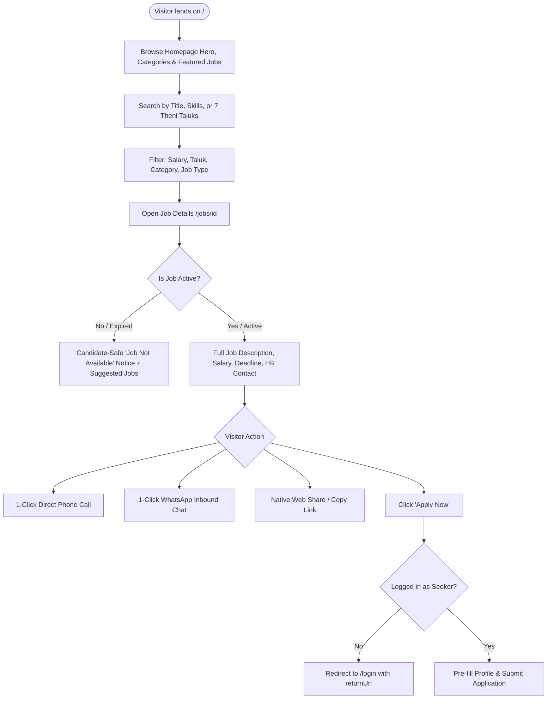
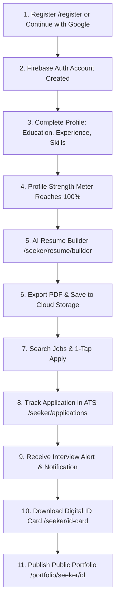
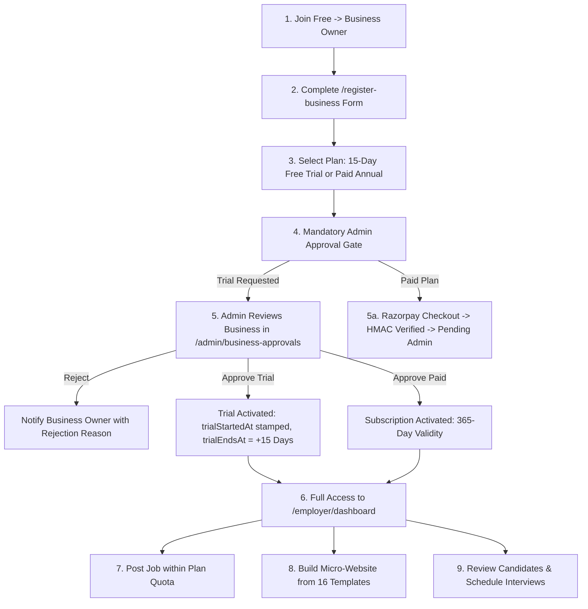
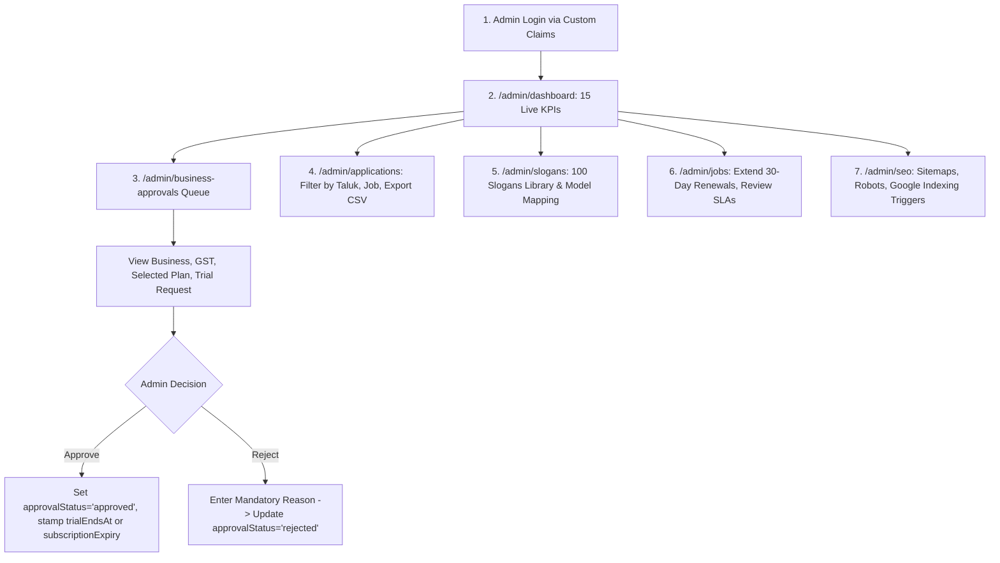
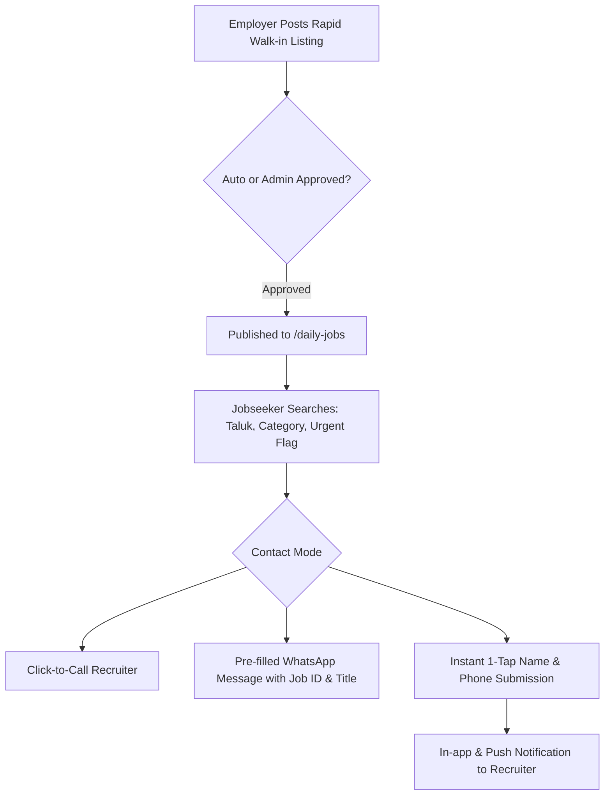
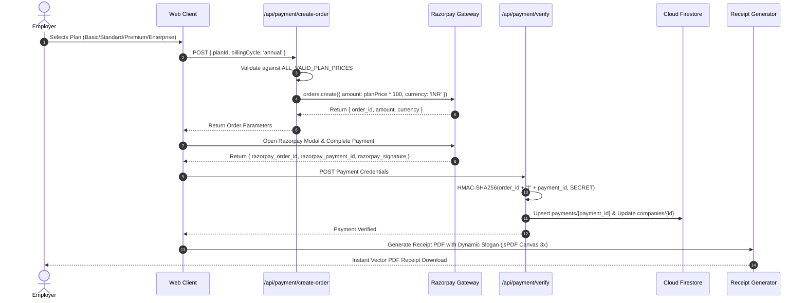

# THENIJOBS — Complete Workflow Documentation & Operational Guide

> **Platform:** THENIJOBS Hyperlocal Employment & Business Portal  
> **Production URLs:** `https://www.thenijobs.com` (Canonical) | `https://www.thenijobs.in` (301 Redirect)  
> **Architecture:** Next.js 16.3.4 (App Router) + React 19.2.4 + Firebase Backend + Razorpay  
> **Coverage:** All 6 Roles (Visitor, Seeker, Employer/Business Owner, Ambassador, Admin, Super Admin)  
> **Audit Status:** Verified against Source Code & Executed Test Suites (October 2026)  

---

## 1. Visitor Complete Workflow



### Detailed Operational Steps:
1. **Discovery:** Visitors access `https://www.thenijobs.com`. Edge routing enforces canonical HTTPS and bilingual language preferences (English / Tamil).
2. **Hyperlocal Navigation:** Visitors can browse directly by taluk landing corridors (`/jobs-in-theni`, `/jobs-in-cumbum`, `/jobs-in-bodinayakanur`, `/jobs-in-periyakulam`, `/jobs-in-andipatti`, `/jobs-in-chinnamanur`, `/jobs-in-uthamapalayam`).
3. **Daily Jobs Access:** Quick navigation to `/daily-jobs` for walk-ins, daily wage, and urgent hiring notices requiring no lengthy resume builder.
4. **Marketplace Discovery:** Visitors browse products (`/marketplace`) and services (`/services`) with price filtering, 3-item comparison drawer, and direct WhatsApp seller inquiries.
5. **Safety Invariants:** Expired listings automatically mask recruiter contact details, disallow application submissions, and provide Google-compliant `noindex, follow` directives.

---

## 2. Job Seeker Complete Workflow



### Detailed Operational Steps:
1. **Onboarding:** Candidates register via Google One-Tap, Email/Password, or Phone OTP. System automatically sets `role: 'job_seeker'` in Firestore `users/{uid}`.
2. **Profile Completion:** Navigates to `/seeker/profile` and `/seeker/skills`. Selects from 45+ localized skills (e.g. Tally Prime, Tamil/English Typing, Cardamom Grading, Handloom Weaving, Agriculture Sales).
3. **AI ATS Resume Builder:**
   - Navigates to `/seeker/resume/builder`.
   - Clicks "Auto-Populate from Profile"; personal data flows seamlessly into the resume builder.
   - Leverages AI suggestions to polish achievement bullet points.
   - Generates high-resolution vector PDF using `jsPDF`.
4. **Job Search & 1-Tap Application:**
   - Clicks "Apply Now" on any active listing.
   - Application modal pre-fills candidate details, attaching active resume link.
   - Duplicate prevention logic blocks re-applications to the same job.
   - Application is logged in Firestore `applications/{id}` with status `applied`.
5. **ATS Application Tracking:**
   - Monitors status transitions: `applied` → `under_review` → `shortlisted` → `interview_scheduled` → `hired` or `rejected`.
   - Overdue SLA tracker flags recruiter inactivity if an application remains unreviewed > 7 days.
6. **Digital Credentials:** Candidate downloads personalized Digital ID Card with QR code pointing to their public verified profile at `/portfolio/seeker/[id]`.

---

## 3. Employer & Business Owner Complete Workflow



### Detailed Operational Steps:
1. **Registration:** Business owners enter Business Name, Registration Type (Proprietorship, LLP, Pvt Ltd), GST/MSME number, Contact details, and Theni Taluk.
2. **Plan & Trial Selection:**
   - **Option A (15-Day Free Trial):** Requires zero upfront payment. Stored as `trialRequested: true`.
   - **Option B (Paid Annual Subscription):** Selects Basic (₹999), Standard (₹1,800), Premium (₹3,500), or Enterprise (₹5,000). Completes Razorpay checkout.
3. **Mandatory Admin Approval Gate:** The employer layout (`/employer/layout.tsx`) intercepts all sub-routes. Unapproved accounts display the "Application Under Review" screen.
4. **Admin Approval & Stamping:**
   - Once Admin reviews and clicks "Approve", the server stamps `approvalStatus = 'approved'`, `accountStatus = 'active'`, `trialStartedAt = now()`, and `trialEndsAt = now() + 15 days` (for trials) or `365 days` (for paid plans).
5. **Dashboard Access & Recruitment:**
   - Employer accesses `/employer/dashboard`.
   - Posts vacancies with role, salary range, qualification, location, and contact preferences.
   - Active job count enforced against `PLAN_LIMITS`.
6. **Micro-Website Builder (`/employer/website`):**
   - Chooses from 16 industry-specific templates (Retail, Hospital, School, Textile, Agriculture, Hotel, etc.).
   - Adds catalogues, staff profiles, gallery images, and custom subdomains.
7. **Candidate Management:**
   - Views inbound applicant resumes, reveals phone numbers, and schedules interviews with automated notifications.

---

## 4. Admin Complete Workflow



### Detailed Operational Steps:
1. **Authentication:** Admin accounts must possess `role: 'admin'` or `'super_admin'` verified by Firebase Admin custom claims.
2. **Executive Monitoring (`/admin/dashboard`):** 15 live operational KPIs calculated from real Firestore collections (Active Jobs, Pending Approvals, Total Businesses, Monthly Revenue, Active Trials, Expired Trials, Overdue Applications, etc.).
3. **Business Approval Dossier (`/admin/business-approvals`):**
   - Displays all businesses in `approvalStatus: 'pending'`.
   - Displays plan choice, payment status, GST number, address, and contact details.
   - 1-Click Approval stamps trial or subscription validity and emits approval audit log.
4. **Central Applications Hub (`/admin/applications`):**
   - Monitors all candidate submissions across the platform.
   - Filter by Job Title, Recruiter, Taluk, Date Range, or Status.
   - Single-click CSV export for offline reporting and district employment tracking.
5. **Billing Slogans Management (`/admin/slogans`):**
   - Browse and filter the 100-slogan bilingual library.
   - Map custom slogans to 14 billing models.
   - Live A4 Canvas preview rendering Tamil Unicode at 3x high-DPI.
6. **Job Renewal & Moderation (`/admin/jobs`):**
   - Supervisors can extend job postings by 30 days or archive fraudulent listings.
   - Tracks overdue candidate applications past the 7-day SLA.

---

## 5. Daily Jobs Complete Workflow (`/daily-jobs`)



### Detailed Operational Steps:
1. **Rapid Posting:** Designed for immediate, same-day, and short-notice vacancies (Cashiers, Delivery Drivers, Farm Labor, Security Guards, Cooks, Sales Assistants).
2. **Hyperlocal Filters:** Visitors filter by today's walk-ins, urgent hiring, taluks, and salary brackets.
3. **Zero Friction Contact:** Direct phone dialer and formatted WhatsApp links allow instant connection without mandatory resume uploads.
4. **Lifecycle Expiry:** Daily jobs automatically expire within 72 hours unless extended by the employer.

---

## 6. Marketplace Complete Workflow (`/marketplace` & `/services`)

```mermaid
flowchart TD
    Owner[Business Owner lists Product / Service] --> QuotaCheck{Within Plan Quota?}
    QuotaCheck -->|Exceeded| UpgradePrompt[Prompt to Upgrade Subscription]
    QuotaCheck -->|Allowed| Publish[Publish Listing to Hyperlocal Directory]
    Publish --> PublicView[Live on /marketplace or /services]
    PublicView --> CustomerFilter[Customer Filters by Taluk, Price, Category]
    CustomerFilter --> Compare[Add up to 3 Items to Comparison Drawer]
    CustomerFilter --> Enquire[Click 'Enquire via WhatsApp' or Submit Lead Form]
    Enquire --> LeadRecord[Lead logged in Firestore leads/{id}]
    LeadRecord --> OwnerAlert[Business Owner receives Inbound Lead Alert]
```

### Detailed Operational Steps:
1. **Catalog Management:** Business owners upload product/service photos (<5MB), prices, units (Kg, Piece, Box, Month, Hour), and descriptions.
2. **Quota Enforcement:** Checked against subscription limits (`PLAN_LIMITS`).
3. **Unified Navigation:** Single component handles Products and Services tabs with URL query sync (`?type=services`), preserving active filters.
4. **Hyperlocal Lead Dispatch:** Inquiries generate records in `leads` collection and launch direct WhatsApp chats pre-populated with listing details.

---

## 7. Subscription & Payment Complete Workflow



### Detailed Operational Steps:
1. **Price Validation:** Server strictly validates checkout fees against authoritative `ALL_VALID_PLAN_PRICES` dictionary.
2. **Cryptographic Handshake:** HMAC-SHA256 signature verification guarantees payment origin integrity.
3. **Idempotency:** Payment records are keyed by `razorpay_payment_id`. Duplicate webhooks or repeated verify calls update idempotently.
4. **Slogan Stamping:** Dynamic slogan resolved via 4-tier hierarchy and permanently stamped into payment receipt record.

---

## 8. Founder Profile Complete Workflow

```mermaid
flowchart TD
    Owner[Business Owner] --> Edit[Open /employer/company-profile]
    Edit --> Fill[Enter: Name, Designation, Bio, LinkedIn, Year, Native Place]
    Fill --> Upload[Upload High-Res Founder Photo < 5MB]
    Upload --> Save[Save to companies/{id}.founderProfile]
    Save --> PublicPage[Renders on /company/slug & /[companySlug]]
    PublicPage --> PublicSEO[Injected into LocalBusiness & Organization JSON-LD]
```

### Detailed Operational Steps:
1. **Dossier Fields:** Captures Founder Name, Designation, Photo, Biography, LinkedIn, Established Year, Professional Experience, Founder Message, and Native Place.
2. **Photo Validation:** Validates file type (`image/jpeg`, `image/png`, `image/webp`), size (< 5MB), and dimensions.
3. **Public Presentation:** Featured prominently on the public company profile, micro-website templates, and homepage Founder Showcase.

---

## 9. Error Handling & Recovery Workflows

| Failure Scenario | Automatic Recovery / Handling Workflow | User / Admin Impact |
|---|---|---|
| **Network Drop during Razorpay Checkout** | Client detects timeout; `/api/payment/reconcile` queries Razorpay REST API to verify if payment was captured | User receives payment confirmation without double charging |
| **Duplicate Webhook Delivery** | Firestore document keyed by `razorpay_payment_id`; duplicate payload is recognized as idempotent no-op | Zero duplicate receipts or corrupt quotas |
| **Expired 15-Day Free Trial** | Nightly cron `/api/cron/expire-trials` transitions account to `trial_expired`; `/employer/layout.tsx` presents locked upgrade screen | Read-only mode activated; all jobs and leads remain 100% preserved |
| **Soft-404 Crawl on Expired Job** | Dynamic route `/jobs/[id]` detects expired listing and injects `noindex, follow` robots meta tag + candidate-safe banner | Search engine index cleans up without 404 ranking penalties |
| **Invalid Cron Authorization** | `/api/cron/*` verifies `Bearer CRON_SECRET` using `crypto.timingSafeEqual`; returns 401 Unauthorized on mismatch | Timing attack vulnerabilities completely mitigated |
| **Tamil Font Canvas Rasterization Failure** | Fallback font stack (`Mukta Malar` → `Noto Sans Tamil` → `Latha` → `Nirmala UI` → `sans-serif`) ensures text never clips or renders blank | Clean, legible receipt generated across all operating systems |
