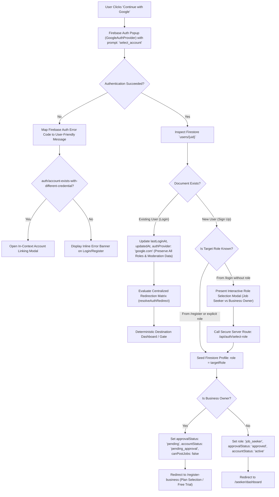

# THENIJOBS Google Sign-In & Automatic Account Creation — Production Architecture & Implementation Report

---

## 1. Executive Summary

This document specifies the complete, production-grade architecture and implementation of **Google Sign-In with Automatic Account Creation** for **THENIJOBS** (`https://www.thenijobs.com`).

The system enables users to click a single, unified **"Continue with Google"** / **"Sign in with Google"** button across all entry points (`/login`, `/register`, `/register-business`). Existing members are authenticated seamlessly without re-registration, while new users have their Firebase Authentication accounts and Firestore user profiles created automatically without having to fill out a redundant manual sign-up form.

---

## 2. Architectural Overview & User Flow



---

## 3. Core Capabilities & Architectural Safeguards

### 3.1. Unified Single Button for Authentication & Account Creation
- **Single Action:** The same `"Continue with Google"` button handles both existing user sign-ins and new user onboarding.
- **Account Switcher:** Google provider is explicitly configured with `googleProvider.setCustomParameters({ prompt: 'select_account' })`, allowing users with multiple Google accounts to choose the desired identity every time.
- **Zero Form Redundancy:** New users signing in via Google do not have to fill out full name, email, or password forms; their identity is securely provisioned from verified Google credentials.

### 3.2. Automatic User Document Seeding (`users/{uid}`)
For newly provisioned Google users, Firestore document schema is populated deterministically:
```typescript
{
  uid: string;                 // Firebase Auth UID
  email: string;               // Verified Google email
  displayName: string;         // Google profile display name
  photoURL?: string;           // Google profile photo
  phone?: string;              // Linked phone (if available)
  role: 'job_seeker' | 'business_owner';
  isVerified: true;            // Google accounts are pre-verified
  authProvider: 'google.com';  // Provider identifier
  createdAt: serverTimestamp();
  updatedAt: serverTimestamp();
  lastLoginAt: serverTimestamp();
}
```

### 3.3. Preservation of Existing Profiles (Anti-Tampering)
When an existing user signs in with Google:
- **Zero Field Overwrite:** The existing user's `role`, `approvalStatus`, `accountStatus`, `selectedPlan`, `companyId`, `adminRole`, `subscriptionStatus`, and trial dates are strictly preserved.
- **Metadata Update Only:** Only `lastLoginAt`, `updatedAt`, and `authProvider: 'google.com'` are updated. If the user previously lacked a `photoURL`, it is non-destructively enriched from Google.

### 3.4. Role Assignment & Privilege Escalation Prevention
- **Strict Role Boundaries:** Public Google sign-in and role selection allow only two roles:
  1. `job_seeker`
  2. `business_owner`
- **Zero Self-Assigned Administrative Privileges:** Any request attempting to assign or escalate to `admin` or `super_admin` is rejected with HTTP 403 Forbidden.
- **Server-Side Role Guard (`/api/auth/select-role`):** Role assignment is validated server-side using the Firebase Admin SDK (`getAdminFirestore()`), ensuring client-side Firestore security rules cannot be manipulated. Existing administrative users cannot have their roles changed.

### 3.5. Mandatory Business Owner Approval Invariant
- **No Instant Dashboard Write Access:** A new Business Owner signing up through Google is assigned `approvalStatus: 'pending'` and `canPostJobs: false`.
- **Plan & Trial Selection:** The user is immediately routed to `/register-business` to pick their 15-Day Free Trial (₹0) or Annual Subscription Plan (Basic, Standard, Premium, Enterprise).
- **Approval Gate:** The Business Owner is restricted to the review screen until an authorized Admin explicitly approves their profile.

---

## 4. Centralized Redirection Matrix

Implemented in `src/lib/authRedirect.ts` via `resolveAuthRedirect(user, customRedirectUrl)`:

| # | Role & Status Condition | Redirect Destination | Screen / User Experience |
|---|---|---|---|
| **1** | Admin / Super Admin (`admin`, `super_admin`) | `/admin/dashboard` | Executive Admin Portal with 15-Metric Dashboard |
| **2** | Job Seeker (`job_seeker`) | `/seeker/dashboard` *(or safe relative URL)* | Full Seeker Hub with job search, applications, saved jobs |
| **3** | Business Owner (Approved & Active) | `/employer/dashboard` *(or safe relative URL)* | Business Owner Dashboard with jobs, candidates, leads |
| **4** | Business Owner (Rejected) | `/register-business` | Revision Screen with rejection reason & Admin WhatsApp support |
| **5** | Business Owner (Plan Not Selected) | `/register-business?step=plan` | Step 2 Plan Selection (15-Day Free Trial or Annual Plans) |
| **6** | Business Owner (Pending Admin Review) | `/register-business` | Waiting Screen (Paid or Free Trial Dossier under review) |
| **7** | Business Owner (Trial Expired) | `/employer/dashboard` | Gated Trial Expired Screen with "Choose a Plan" checkout |
| **8** | Unassigned / Missing Role Selection | `/register` | Public Role Selection screen (Job Seeker vs Business Owner) |

### Open Redirect Defense
All custom redirect URLs (e.g. `?redirect=...`) are strictly sanitized via `isSafeRedirectUrl()`:
- Must begin with a single `/`
- Protocol-relative URLs (`//evil.com`) are rejected
- External schemes (`https:`, `http:`, `javascript:`, `data:`) are rejected

---

## 5. Account Linking & Error Handling

### 5.1. Handling `auth/account-exists-with-different-credential`
When a user who originally created an account with Email/Password clicks "Continue with Google" using the same email address:
1. Firebase Auth throws `auth/account-exists-with-different-credential`.
2. The error is intercepted gracefully in `src/app/login/page.tsx`.
3. The pending Google credential is extracted via `GoogleAuthProvider.credentialFromError(err)`.
4. An in-context **Account Linking Modal** appears:
   - Identifies the matching email address.
   - Prompts the user to enter their account password once.
   - Calls `linkGoogleAccount(email, password, pendingCredential)` in `AuthContext`.
   - Links Google OAuth to the existing user's UID without creating a duplicate account or losing existing Firestore data.
   - Signs the user in and routes to their dashboard.

### 5.2. Friendly Error Mapping
`getFriendlyAuthErrorMessage()` translates technical Firebase error codes into human-friendly explanations:
- `auth/popup-closed-by-user` → *"Sign-in was cancelled. The Google window was closed before completing."*
- `auth/popup-blocked` → *"The Google sign-in popup was blocked by your browser. Please allow popups for this site and try again."*
- `auth/unauthorized-domain` → *"This domain is not authorized for Google Sign-In in Firebase Console."*
- `auth/operation-not-allowed` → *"Google Sign-In is not enabled in Firebase Authentication console."*
- `auth/network-request-failed` → *"Network connection error during sign-in. Please check your internet connection."*
- `auth/user-disabled` → *"This user account has been disabled by an administrator. Please contact support."*

---

## 6. Implementation File Manifest

| File Path | Description |
|---|---|
| `src/lib/authRedirect.ts` | Centralized 8-state redirection engine, open-redirect security guard, and friendly error mapper |
| `src/app/api/auth/select-role/route.ts` | Server-side API endpoint for role selection with admin privilege escalation protection |
| `src/contexts/AuthContext.tsx` | Upgraded with `signInWithGoogle(targetRole)`, `assignUserRole()`, `linkGoogleAccount()`, and `prompt: 'select_account'` |
| `src/app/login/page.tsx` | Login page with Google button, Role Selection Modal for new Google users, and Account Linking Modal |
| `src/app/register/page.tsx` | Register page with 1-click Google Sign-up in Step 1 and Step 2 bound to selected role |
| `src/app/register-business/page.tsx` | Business owner onboarding with 1-click Google registration and plan/trial selection |
| `src/lib/types/index.ts` | Added `authProvider?: string` and `authMethod?: string` to `User` profile interface |
| `tests/google-auth.test.mjs` | Automated 16-test suite covering Google provider config, profile seeding, redirect matrix, and security invariants |
