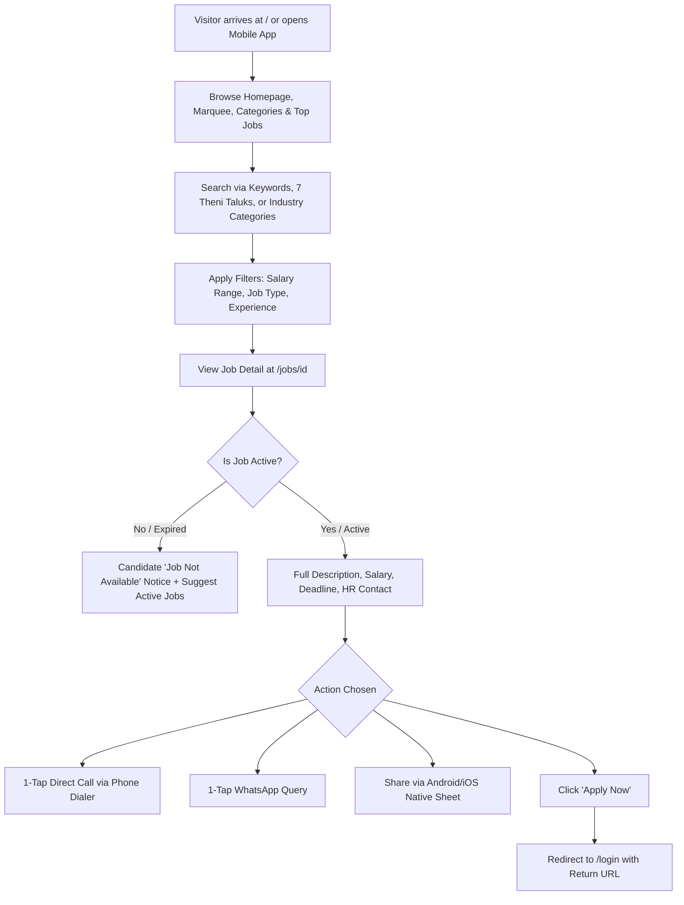
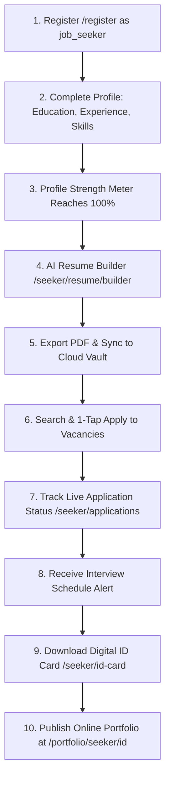
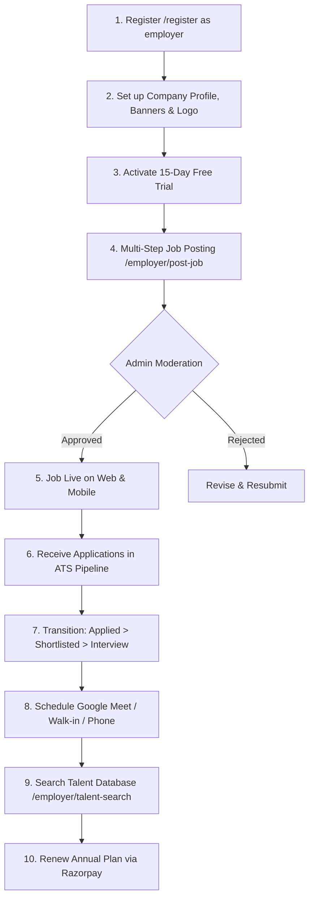
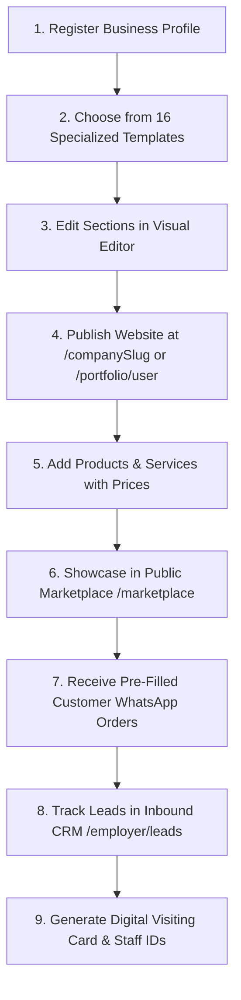
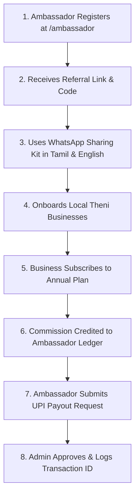
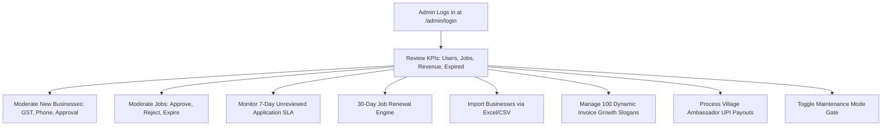

# THENIJOBS — Complete Workflow Documentation & Operational Guide

> **Platform:** THENIJOBS Hyperlocal Portal & Cross-Platform Mobile Ecosystem  
> **Environment:** Next.js 16.3.4 (App Router) + Flutter 3.x (Dart 3.13.5) + Firebase Cloud Backend  
> **Coverage:** All 8 Supported Roles & System Automation Pipelines  
> **Last Verification:** October 2026 Production Release  

---

## 1. Unauthenticated Visitor Journey



### Detailed Steps:
1. **Discovery:** Visitors land on `https://www.thenijobs.com` or launch the Flutter mobile app (`SplashScreen` hydrates cached credentials).
2. **Hyperlocal Navigation:** Access taluk landing pages (`/jobs-in-theni`, `/jobs-in-cumbum`, `/jobs-in-bodinayakanur`, `/jobs-in-periyakulam`, `/jobs-in-andipatti`, `/jobs-in-chinnamanur`, `/jobs-in-uthamapalayam`).
3. **Safety Protection:** Expired jobs automatically display candidate-safe notices without exposing recruiter WhatsApp numbers or renewal links.

---

## 2. Job Seeker Complete Lifecycle



### Detailed Operational Steps:
1. **Registration:** Signs up via Email/Password, Google OAuth, or Phone OTP. System creates profile in `users/{uid}` with `role: 'job_seeker'`.
2. **Profile Completion:**
   - Navigates to `/seeker/profile` and `/seeker/skills`.
   - Selects from 45+ localized Theni skills (e.g. Tally Prime, Tamil/English Typing, Cardamom Grading, Handloom Weaving).
   - Profile Strength meter dynamically updates (0–100%).
3. **AI ATS Resume Generation:**
   - Visits `/seeker/resume/builder`.
   - Clicks **"Auto-Populate from Profile"**; Firestore details flow into builder.
   - Uses AI assistant (`/api/ai`) to rephrase duties into quantified, high-impact bullet points.
   - Exports via high-resolution canvas PDF (`jsPDF`) or vector print engine (`window.print()`).
4. **1-Tap Job Application:**
   - Clicks **"Apply Now"** on any active listing.
   - Bottom sheet modal pre-fills user details and attaches active resume link.
   - Duplicate protection prevents applying twice to the same job ID.
   - Generates record in `applications` and dispatches in-app notification to recruiter.
5. **Live Tracking:**
   - Monitors status transitions: `Applied` → `Under Review` → `Shortlisted` → `Interview Scheduled` → `Hired` or `Rejected`.
6. **Career Coaching & Digital Credentials:**
   - Consults `/seeker/ai-coach` for interview preparation.
   - Downloads Digital ID card with QR code pointing to `/portfolio/seeker/[id]`.

---

## 3. Employer & Recruiter Complete Workflow



### Detailed Operational Steps:
1. **Onboarding:** Employer registers, creates company profile, and receives a 15-day free trial.
2. **Job Posting Engine:**
   - Steps through title, industry category, Theni taluk, job type, salary min/max, vacancies, and application deadline.
   - Validates data and stores in `jobs` with `status: 'pending'` (or `active` if pre-verified).
3. **ATS Candidate Management:**
   - Recruiter reviews applicant list at `/employer/candidates`.
   - Inspects candidate resume, contact details, and qualifications.
   - Drags candidate or clicks status pill (`Shortlisted`, `Interview Scheduled`, `Hired`, `Rejected`).
   - Candidate instantly receives synchronized push/in-app notification.
4. **Talent Sourcing:**
   - Searches verified local candidates at `/employer/talent-search` with filter chips for taluk and open-to-work status.
5. **Subscription Upgrade:**
   - Upgrades to Basic (₹999), Standard (₹1,800), Premium (₹3,500), or Enterprise (₹5,000) via Razorpay.
   - Verified signature issues dynamic slogan receipt with immediate PDF download.

---

## 4. Business Owner & Merchant Workflow



### 16 Industry Website Templates:
1. `Modern Clean` (Agencies, Consultants)
2. `Corporate Prime` (Enterprises, Institutions)
3. `Creative Agency` (Design, Media Studios)
4. `Minimal Elegance` (Boutique, Architecture)
5. `Local Retail & Supermarket` (Provisions, Grocery)
6. `Healthcare & Clinic` (Hospitals, Doctors, Diagnostics)
7. `Restaurant & Cafe` (Hotels, Bakeries, Cloud Kitchens)
8. `Education & Coaching` (Schools, Tuition, TNPSC Academies)
9. `Real Estate & Builders` (Plots, Construction, Civil Engineers)
10. `Automobile & Workshop` (Showrooms, Bike & Car Service)
11. `Agriculture & Spices` (Cardamom, Pepper, Grape Farms)
12. `Textile & Handloom` (Cotton Mills, Weavers, Saree Showrooms)
13. `Professional Services` (Auditors, Lawyers, Tax Consultants)
14. `Tech & Software` (IT Services, BPO, Hardware Repair)
15. `Industrial & Manufacturing` (Packaging, Fabrication, Machine Works)
16. `Wholesale & B2B Distribution` (Agro-machinery, Fertilizers, Distribution)

---

## 5. Village Ambassador & Referral Network



### Commission Matrix:
- **Basic Plan (₹999/yr):** ₹150 commission
- **Standard Plan (₹1,800/yr):** ₹350 commission
- **Premium Plan (₹3,500/yr):** ₹700 commission
- **Enterprise Plan (₹5,000/yr):** ₹1,000 commission

---

## 6. Admin & Platform Governance Workflow



### Key Supervisory Modules:
1. **7-Day SLA Monitoring:** Identifies job applications unreviewed by employers > 7 days. Provides 1-click WhatsApp reminder to HR.
2. **30-Day Job Renewal Engine:** Reactivates expired jobs with a single click, extending deadline by 30 days and logging audit entries.
3. **Dynamic Slogan Manager:** Admin CRUD for 100 master business growth slogans in English and Tamil, rotating sequentially on every customer tax invoice.
4. **Maintenance Mode Gate:** Allows administrators to take the public site offline for maintenance while `/admin/*` and `/login` remain operational.

---

## 7. Automated Nightly Cron Engine

### A. Nightly Job Expiry (`/api/cron/expire-jobs`)
- **Execution Schedule:** `0 1 * * *` (01:00 UTC daily via Vercel Cron).
- **Authentication:** `CRON_SECRET` timing-safe check and `x-vercel-cron` header.
- **Workflow:**
  1. Queries Firestore `jobs` where `status: 'active'`.
  2. Compares `deadline` / `expiryDate` with current server timestamp.
  3. Batch updates expired jobs to `status: 'expired'`, `isActive: false`.
  4. Dispatches notification to employer with direct renewal link.
  5. Records audit entry in `activityLogs`.

### B. Daily Trial & Subscription Expiry (`/api/cron/expire-trials`)
- **Execution Schedule:** `0 0 * * *` (00:00 UTC daily via Vercel Cron).
- **Authentication:** `CRON_SECRET` timing-safe check.
- **Workflow:**
  1. **Batch 1 (15-Day Free Trials):** Finds companies where `trialEndDate < now` and `paymentStatus != 'paid'`. Sets `subscriptionStatus: 'trial_expired'`, `accountStatus: 'suspended'`.
  2. **Batch 2 (1-Year Paid Subscriptions):** Finds companies where `subscriptionEndDate < now` and `paymentStatus == 'paid'`. Sets `subscriptionStatus: 'subscription_expired'`, `accountStatus: 'suspended'`.
  3. Suspends public directory profile and connected website builder URL.
  4. Notifies company owner via email and in-app alert.

---

## 8. Razorpay Payment, Auto-Receipt & Dual Reconciliation Flow

```mermaid
graph TD
    SelectPlan[Select Plan: Basic ₹999 / Standard ₹1800 / Premium ₹3500 / Enterprise ₹5000] --> CreateOrder[/api/payment/create-order]
    CreateOrder --> Modal[Razorpay Checkout Modal Launches]
    Modal --> UserPays[Customer Completes Payment via UPI/Card/NetBanking]
    
    UserPays -->|Success Callback| ClientVerify[/api/payment/verify]
    UserPays -->|Server Webhook| Webhook[/api/payment/webhook]
    
    ClientVerify --> DualCheck{Dual Verification Check}
    DualCheck -->|1. HMAC SHA-256 Valid| Verified[Cryptographically Confirmed]
    DualCheck -->|2. REST Fallback Query| Confirmed[API Confirmed with Razorpay]
    
    Verified --> FSWrites[Save to payments & Activate Company Subscription]
    Confirmed --> FSWrites
    Webhook --> FSWrites
    
    FSWrites --> AutoPDF[Generate Vector PDF Receipt THENI-REC-HASH]
    AutoPDF --> AutoDownload[Trigger Automatic Browser PDF Download]
    
    UserPays -->|Network Drop / Delayed Write| ReconcileUI[Reconciling Modal UI]
    ReconcileUI --> Polling[/api/payment/reconcile]
    Polling --> FSWrites
```

### Security & Idempotency Rules:
- Dual-path cryptographic HMAC-SHA256 signature verification + Razorpay REST fallback.
- `set(..., { merge: true })` prevents Firestore `5 NOT_FOUND` crashes.
- Automatic vector PDF receipt download eliminates missing receipts.
- Self-healing reconciliation endpoint (`/api/payment/reconcile`) recovers delayed bank debits without asking the user to repay.
