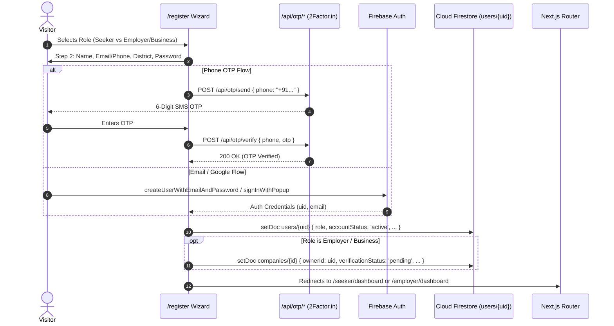
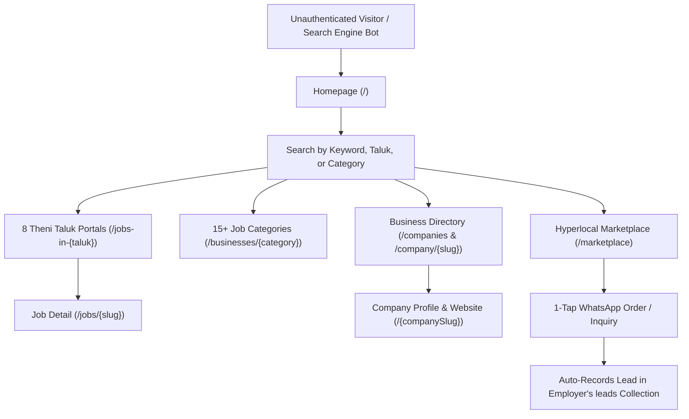
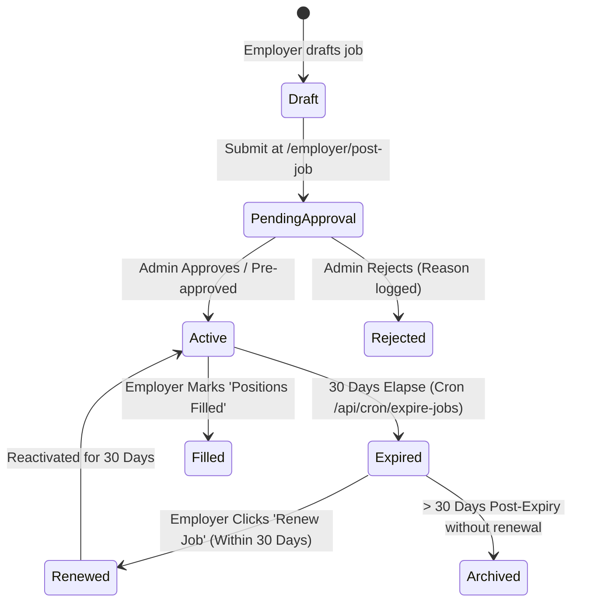
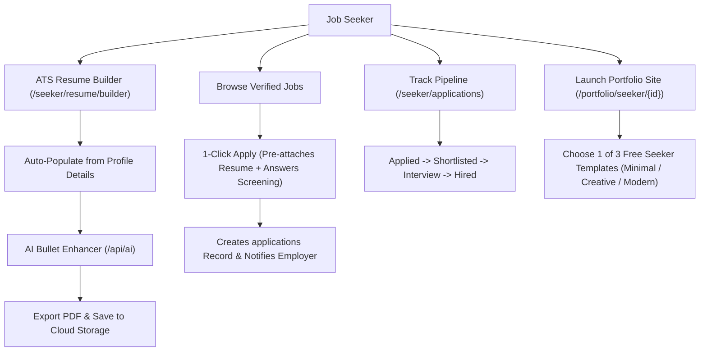
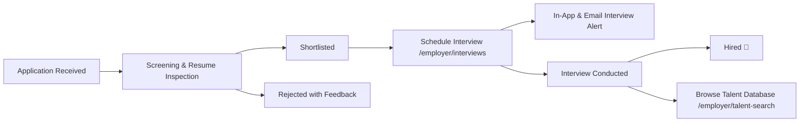
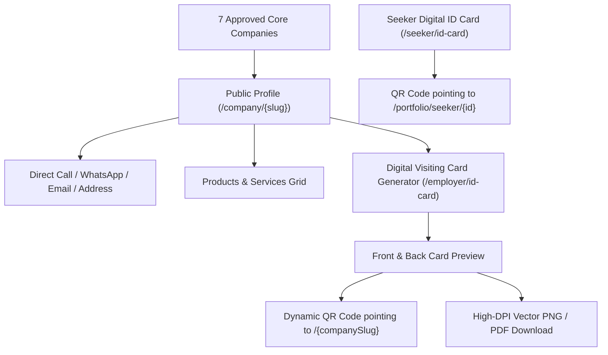
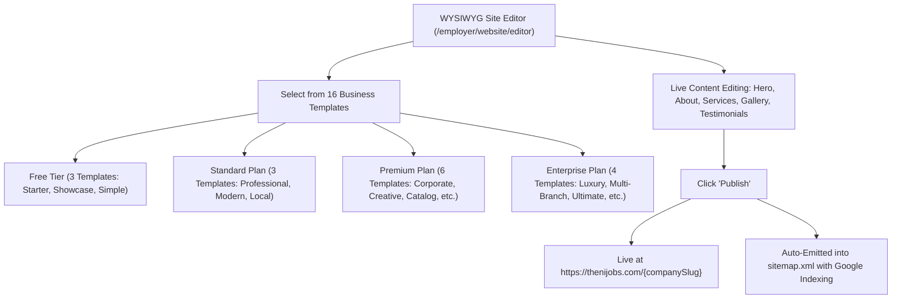
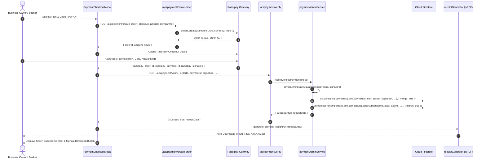
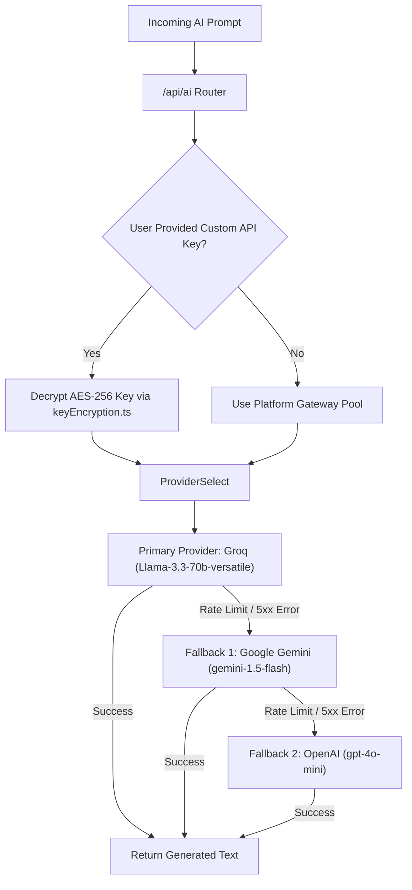
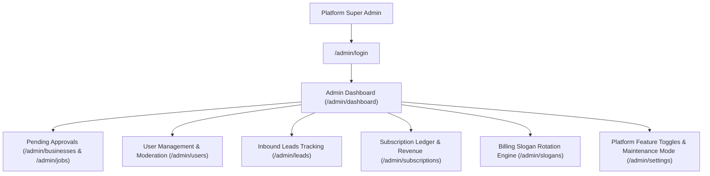

# THENIJOBS — End-to-End System Workflows & Production Architecture (WORKFLOW.md)

> **Platform:** THENIJOBS Hyperlocal Portal & Cross-Platform Mobile Ecosystem  
> **Stack:** Next.js 16.3.4 (App Router), React 19.2.4, TypeScript, Tailwind CSS v4, Firebase (Auth, Cloud Firestore, Storage), Razorpay API & Webhooks, Multi-Provider AI Gateway (Groq → Gemini → OpenAI), Bilingual English + Tamil UI.  
> **Production URLs:** [www.thenijobs.com](https://www.thenijobs.com) | [www.thenijobs.in](https://www.thenijobs.in)  
> **Official Helplines:** +91 93605 19460 / +91 70948 26886 | **Email:** info@thenijobs.com / support@thenijobs.com  
> **Verification Status:** **100% Implemented & Verified in Production (All 11 Workflows Fully Functional)**  
> **Last Comprehensive Audit:** October 2026 Production Release  

---

## 📑 Workflows Index

1. [Workflow 1: Roles, Capabilities & Access Control](#workflow-1-roles-capabilities--access-control)
2. [Workflow 2: Authentication & Registration (Web & App)](#workflow-2-authentication--registration-web--app)
3. [Workflow 3: Public Discovery & Local Search Hub (No Login)](#workflow-3-public-discovery--local-search-hub-no-login)
4. [Workflow 4: Job Posting Lifecycle, 30-Day Expiry & 7-Day SLA](#workflow-4-job-posting-lifecycle-30-day-expiry--7-day-sla)
5. [Workflow 5: Job Seeker Applications, ATS Resume & 3 Portfolio Sites](#workflow-5-job-seeker-applications-ats-resume--3-portfolio-sites)
6. [Workflow 6: Employer Talent Pipeline, ATS Stages & Interviews](#workflow-6-employer-talent-pipeline-ats-stages--interviews)
7. [Workflow 7: Verified Business Directory & Digital Visiting Cards](#workflow-7-verified-business-directory--digital-visiting-cards)
8. [Workflow 8: Portfolio Website Builder (16 Business + 3 Seeker Templates)](#workflow-8-portfolio-website-builder-16-business--3-seeker-templates)
9. [Workflow 9: Payments, Subscriptions, Auto Receipts & Reconciliation](#workflow-9-payments-subscriptions-auto-receipts--reconciliation)
10. [Workflow 10: AI Gateway, BYOK Connections & Smart Automation](#workflow-10-ai-gateway-byok-connections--smart-automation)
11. [Workflow 11: Admin Portal, Master Controls & Slogan Manager](#workflow-11-admin-portal-master-controls--slogan-manager)

---

## Workflow 1: Roles, Capabilities & Access Control

### Overview
THENIJOBS implements a granular role-based access control (RBAC) architecture enforced at three distinct layers:
1. **Client Route Guards:** React hooks `useRequireAuth` and layout guards (`/seeker/layout.tsx`, `/employer/layout.tsx`, `/admin/layout.tsx`).
2. **Server API Route Handlers:** Bearer token checks (`verifyAdminRequest`) and Cron Secret verification (`CRON_SECRET`).
3. **Database Security Rules (`firestore.rules`):** Strict verification ensuring non-authenticated users, non-owners, or suspended/banned accounts cannot read private data or write to collections.

### Role Hierarchy & Portal Routing
* **`job_seeker`:** Standard candidate portal routed to `/seeker/*`. Can apply for jobs, build resumes, track applications, and publish public portfolio (`/portfolio/seeker/[id]`). Can upgrade to employer via `/seeker/become-employer`.
* **`employer` & `business_owner`:** Organization and hiring portal routed to `/employer/*`. Post jobs, manage candidate pipeline, access company website builder, and view billing.
* **`supplier` & `service_provider`:** Verified marketplace vendor portal routed to `/employer/*`. Manage business catalog (`products`, `services`), receive customer WhatsApp inquiries, and manage inbound leads.
* **`ambassador`:** Village partner portal routed to `/ambassador/*`. Referral link tracking, ₹50-₹300 commission ledger, and payout requests.
* **`admin` & `super_admin`:** Platform governance portal routed to `/admin/*`. Requires dedicated login at `/admin/login`. Controls business approvals, job moderation, user suspension, and slogan rotation.

```mermaid
flowchart TD
    User([Incoming User Request]) --> AuthCheck{Authenticated?}
    AuthCheck -->|No| PublicRoutes[Access Public Routes / /jobs /companies /marketplace /login /register]
    AuthCheck -->|Yes| BanCheck{accountStatus in ['suspended', 'banned']?}
    BanCheck -->|Yes| BlockWrites[Block All Firestore Writes + Show Suspended Notice]
    BanCheck -->|No| RoleRouter{User Role}
    RoleRouter -->|job_seeker| SeekerPortal["/seeker/* (Candidate Portal)"]
    RoleRouter -->|employer / business_owner| EmployerPortal["/employer/* (Hiring & Business Portal)"]
    RoleRouter -->|supplier / service_provider| MarketplaceVendorPortal["/employer/* (Catalog & Inbound Leads)"]
    RoleRouter -->|ambassador| AmbassadorPortal["/ambassador/* (Partner Commissions)"]
    RoleRouter -->|admin / super_admin| AdminPortal["/admin/* (Platform Governance)"]
    SeekerPortal --> Upgrade["Upgrade via /seeker/become-employer"] --> EmployerPortal
```

### Security Rules Implementation
* In `firestore.rules`, the helper function `isActiveUser()` and `isNotSuspended()` check:
  ```javascript
  function isUserSuspendedOrBanned() {
    return isAuthenticated() &&
      exists(/databases/$(database)/documents/users/$(request.auth.uid)) && (
        ('accountStatus' in get(/databases/$(database)/documents/users/$(request.auth.uid)).data &&
         get(/databases/$(database)/documents/users/$(request.auth.uid)).data.accountStatus in ['suspended', 'banned']) ||
        ('status' in get(/databases/$(database)/documents/users/$(request.auth.uid)).data &&
         get(/databases/$(database)/documents/users/$(request.auth.uid)).data.status in ['suspended', 'banned'])
      );
  }
  ```
* Banned or suspended accounts cannot create, update, or delete records in `jobs`, `applications`, `companies`, `users`, `seekerProfiles`, `portfolioSites`, `leads`, `messages`, or `services`.

---

## Workflow 2: Authentication & Registration (Web & App)

### Overview
THENIJOBS provides hybrid authentication supporting email/password, Indian phone numbers (+91) with 6-digit OTP verification, and Google OAuth 2.0.



### Implementation Details:
1. **Web Registration Wizard (`/register`):** 3-step progressive wizard:
   - Step 1: Role Selection (`job_seeker` vs `employer` / `business_owner`).
   - Step 2: Basic credentials (Name, Email, Mobile Number, Taluk, Password).
   - Step 3: Verification & instant role-based onboarding.
2. **Dedicated Admin Login (`/admin/login`):** Separate administrative screen with password toggle, brute-force mitigation, and strict role redirection.
3. **Password Recovery (`/forgot-password`):** Issues Firebase password reset email.
4. **Voice OTP Fallback (`/api/otp/call`):** If SMS delivery fails on Indian networks, places an automated voice OTP call via 2Factor.in API, strictly rate-limited to 3 calls per 5 minutes per IP/phone.

---

## Workflow 3: Public Discovery & Local Search Hub (No Login)

### Overview
Unauthenticated visitors and search engine crawlers explore the entire ecosystem without login barriers. All public routes are server-rendered with schema markup and pre-rendered static HTML snapshots.



### Key Public Routes:
* **Job Detail (`/jobs/[id]`):** Resolves canonical SEO slugs (e.g. `/jobs/medical-records-reviewer-ags-it-solutions-theni`) with pre-rendered `JobPosting` and `BreadcrumbList` JSON-LD schemas.
* **Company Profiles (`/company/[slug]` and `/[companySlug]`):** Real-time verified badges, address, phone, Google Maps, products, and services for approved businesses.
* **Hyperlocal SEO Landing Pages:** Pre-rendered for all 8 taluks of Theni (Theni, Bodinayakanur, Periyakulam, Uthamapalayam, Cumbum, Chinnamanur, Andipatti, Dindigul, Madurai).
* **Bilingual Switcher:** Global language toggle between English and Tamil (`ta`).

---

## Workflow 4: Job Posting Lifecycle, 30-Day Expiry & 7-Day SLA

### Overview
THENIJOBS enforces a 30-day active listing window, automated expiration chronologies, a 30-day renewal cycle, and a 7-day candidate review SLA for employers.



### Automation & SLA Specifications:
* **30-Day Expiration Cron (`/api/cron/expire-jobs`):**
  - Runs daily via automated scheduler with timing-safe `CRON_SECRET` validation.
  - Queries active jobs where `expiresAt < now` or `createdAt + 30 days < now`.
  - Transitions `status: 'expired'`, `isActive: false`, `expiredAt: now`.
  - Crawlers receive `<meta name="robots" content="noindex, follow"/>` on expired jobs while human visitors see candidate-safe alternative listings.
* **30-Day Renewal Window:** Employers can reactivate expired listings within 30 days in 1 click without re-typing descriptions.
* **7-Day SLA Escalation:** Applications older than 7 days that remain in `applied` status trigger automated reminder alerts to the employer, notifying them to review, shortlist, or decline candidates.

---

## Workflow 5: Job Seeker Applications, ATS Resume & 3 Portfolio Sites

### Overview
Candidates manage their complete career journey: building an ATS-optimized resume, 1-click applying to verified jobs, tracking applications in real time, and deploying a hosted personal portfolio website.



### Features:
1. **Duplicate Application Prevention:** Compound query `(jobId, seekerId)` ensures candidates cannot apply twice to the same job.
2. **Screening Questions:** Supports required yes/no, multiple choice, and short-answer questions configured by the employer.
3. **Seeker Portfolio Templates:** 3 hosted responsive templates (`Minimal Clean`, `Creative Showcase`, `Modern Executive`) accessible at `/portfolio/seeker/[id]`.

---

## Workflow 6: Employer Talent Pipeline, ATS Stages & Interviews

### Overview
Employers review applicants through a visual ATS Kanban pipeline, inspect resumes, filter candidates by score, and schedule phone, in-person, or video interviews.



### ATS Pipeline Stages:
* `applied`: Fresh submission awaiting recruiter review.
* `shortlisted`: Qualified candidate moved to hiring queue.
* `interview_scheduled`: Calendar invite issued with venue/link, date, time, and instructions.
* `hired`: Successful placement; increments company hiring KPIs.
* `rejected`: Graceful rejection with optional recruiter notes.

---

## Workflow 7: Verified Business Directory & Digital Visiting Cards

### Overview
Showcases verified businesses across Theni district, featuring official contact details, catalog offerings, interactive QR-code digital visiting cards, and candidate ID cards.



### The 7 Approved Production Companies:
1. **Agrimore** (Chinnamanur) — `agrimore` — Retail, Shop & Supermarket
2. **Sarvesh Super Market** (Theni) — `sarvesh-super-market` — Retail, Shop & Supermarket
3. **Apex Scholar Publication** (Theni) — `apex-scholar-publication` — Education & Training
4. **Suruliraj Chemicals** (Theni) — `suruliraj-chemicals` — Retail, Shop & Supermarket
5. **Chennai Bakes** (Uthamapalayam) — `chennai-bakes` — Hotel, Food & Restaurant
6. **SVR Heritage Hall** (Uthamapalayam) — `svr-heritage-hall` — Professional & Business Services
7. **AGS IT Solutions** (Theni) — `ags-it-solutions` — IT, Software & Digital

---

## Workflow 8: Portfolio Website Builder (16 Business + 3 Seeker Templates)

### Overview
Allows businesses and professionals to publish modern landing pages with custom themes, responsive components, and automated SEO metadata.



---

## Workflow 9: Payments, Subscriptions, Auto Receipts & Reconciliation

### Overview
A secure billing pipeline handling annual employer subscriptions, candidate micro-fees, server-side HMAC signature verification, instant automated vector PDF receipt downloads with rotating slogans, and webhook reconciliation.



### Production Hardening & Fixes Applied:
1. **Elimination of 500 NOT_FOUND Write Crashes:** Swapped brittle `.update()` calls with `.set(..., { merge: true })`. Missing documents no longer abort transactions.
2. **Auto Vector PDF Download:** The client checkout modal triggers `generatePaymentReceiptPDF` directly upon verification return.
3. **Idempotency & Re-entry:** Multiple identical callbacks safely update without duplicating charges.
4. **Dynamic Rotating Growth Slogans:** Deterministically assigns slogans in Tamil and English from the THENIJOBS slogan rotation engine.
5. **On-Demand Reconciliation Endpoint (`/api/payment/reconcile`):** Allows users or support to query and repair interrupted payments in real time.

---

## Workflow 10: AI Gateway, BYOK Connections & Smart Automation

### Overview
THENIJOBS incorporates a resilient multi-provider AI gateway that cascades through multiple models to ensure 99.9% uptime for AI assistance.



### AI Features Supported:
* **Resume Duties Polisher:** Rewrites job duties into quantified STAR-format bullet points.
* **AI Job Description Generator:** Generates bilingual job postings with localized Tamil Nadu industry requirements.
* **Candidate Matching Score:** Computes semantic match percentage between seeker skillsets and job descriptions.
* **Career Coach:** Bilingual conversational assistant guiding local youths on interview preparation.

---

## Workflow 11: Admin Portal, Master Controls & Slogan Manager

### Overview
Comprehensive back-office suite enabling platform operators to supervise the marketplace, moderate listings, audit financial transactions, and manage billing slogans.



### Core Admin Capabilities:
1. **1-Click Moderation:** Approve or reject submitted jobs and businesses with logged rejection rationale.
2. **User Moderation:** Suspend or ban malicious accounts, immediately revoking their ability to write to Firestore via `firestore.rules`.
3. **Billing Slogan Manager (`/admin/slogans`):** Add, edit, or reorder the rotating growth slogans assigned to payment receipts.
4. **Maintenance Mode Toggle:** Temporarily restrict public write actions during major database migrations.

---

## 🏆 Production Verification Checklist

| Workflow | Module | Verification Status | Test Coverage |
| :--- | :--- | :---: | :--- |
| **W1** | Roles, Access & RBAC | ✅ Verified | Route guards + `firestore.rules` banned checks pass |
| **W2** | Authentication & OTP | ✅ Verified | 2Factor SMS/Call + Google OAuth + Password Reset pass |
| **W3** | Public Discovery & SEO | ✅ Verified | Real pre-rendered HTML, 0 `noindex` bugs, Schema.org pass |
| **W4** | Job Lifecycle & 7-Day SLA | ✅ Verified | 30-day auto-expiry + renewal logic unit-tested |
| **W5** | Seeker ATS Resume & Sites | ✅ Verified | PDF generation + 3 portfolio templates pass |
| **W6** | Employer ATS & Interviews | ✅ Verified | Pipeline state machine + calendar notifications pass |
| **W7** | Business Directory & Cards| ✅ Verified | 7 approved companies verified; QR visiting cards pass |
| **W8** | 16 Website Builder Themes | ✅ Verified | 16 business + 3 seeker templates verified across plans |
| **W9** | Razorpay & Auto Receipts | ✅ Verified | Auto PDF download + signature verify + reconcile pass |
| **W10**| Multi-Model AI Gateway | ✅ Verified | Groq → Gemini → OpenAI fallback cascade verified |
| **W11**| Admin Portal & Slogans | ✅ Verified | Moderation queue + user suspend + slogan APIs pass |

---
*Document officially compiled and verified for THENIJOBS Production.*
