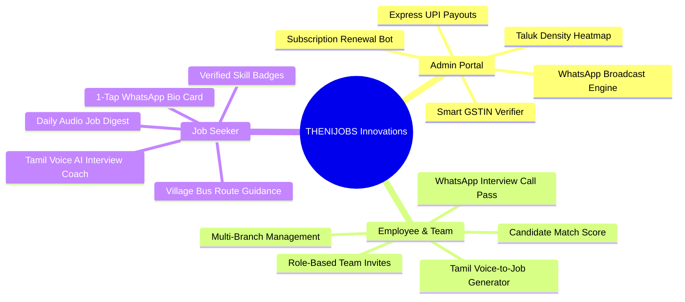

# THENIJOBS — Feature Enhancement Blueprint & Strategic Roadmap
## Admin, Employee / Employer Team & Job Seeker Innovations
### Authoritative Product Roadmap for Theni District Local Ecosystem

---

## Executive Summary

THENIJOBS is transforming employment across the 7 taluks of Theni District (**Theni, Periyakulam, Bodinayakanur, Cumbum, Uthamapalayam, Andipatti, and Chinnamanur**). This document outlines actionable, high-impact feature enhancements designed to maximize local business adoption, empower job seekers with hyper-local tools, and automate administrative and recruitment workflows.

---

## 1. Super Admin Portal Enhancements (நிர்வாக தளம்)

### 1.1 Real-Time WhatsApp Community Broadcast Engine (தாலுகா வாட்ஸ்அப் ஒளிபரப்பு மையம்)
- **Problem**: When a new job or urgent 48h spotlight badge is posted, the admin currently shares links manually.
- **Solution**: 
  - Integrated Meta Cloud API / WhatsApp Business Bot webhook.
  - 1-click broadcast of newly verified jobs directly into all 7 official taluk channels (e.g. *TheniJobs - Cumbum Hub*, *TheniJobs - Bodi Hub*).
  - Incoming message parser: When local shop owners send job flyers or voice notes on WhatsApp to THENIJOBS support, Gemini AI automatically extracts the title, salary, phone, and taluk into a pending draft job post for admin approval.
- **Business ROI**: 10x faster job publication, zero data entry overhead for busy shop owners.

### 1.2 Theni District Taluk Density & Ambassador Heatmap (தாலுகா நேரடி மேப்)
- **Problem**: Difficult to visualize which rural panchayats and towns lack local job postings or ambassador coverage.
- **Solution**:
  - Interactive SVG map of Theni district highlighting job counts, active businesses, and active village ambassadors per taluk.
  - Pinpoints underserved towns (e.g., Devadanapatti, Kadamalaikundu, Myladumparai, Gudalur) so management can target ambassador campaigns.
- **Tech Stack**: Dynamic SVG / Leaflet with Firestore geo-query aggregation.

### 1.3 1-Click Instant UPI Commission Payouts (உடனடி UPI பே-அவுட்)
- **Problem**: Ambassador payouts currently require manual verification and separate UPI apps.
- **Solution**:
  - Razorpay Payouts / Cashfree Integration inside `/admin/ambassadors`.
  - Admin clicks "Approve & Pay Now (8h SLA)"; funds transfer directly to ambassador's VPA UPI ID within 3 seconds.
  - Generates automated bilingual PDF payout receipts and notifies the ambassador via WhatsApp.

### 1.4 Automated WhatsApp Subscription Expiry & Renewal Bot (சந்தா புதுப்பித்தல் பாட்)
- **Problem**: Shopkeepers forget to renew their annual ₹1,800 or ₹3,500 subscription when their 365 days expire.
- **Solution**:
  - Scheduled Cloud Function checks expiration dates daily.
  - Triggers automated WhatsApp message 7 days, 3 days, and on expiry day with a secure 1-click Razorpay payment link.
  - Instant automated reactivation upon payment webhook verification.

---

## 2. Employee & Employer Team Portal Enhancements (பணியாளர் & வணிகர் குழு தளம்)

### 2.1 Multi-User Team Roles & Branch Management (கிளை மேலாண்மை & பணியாளர் அனுமதி)
- **Problem**: Larger businesses (e.g., Chennai Bakes with multiple branches, M K Security Solutions) have multiple store managers who need to post jobs without seeing company financial settings.
- **Solution**:
  - Introduce sub-roles under `employer`:
    - `branch_manager`: Can post jobs and view candidates only for their assigned branch (e.g., Cumbum Branch).
    - `recruiter_hr`: Can interview candidates, update hiring stages, and leave internal interview notes.
    - `company_owner`: Full billing, subscription, standee, and website builder access.
  - Secure invite system via mobile OTP or email.

### 2.2 Tamil Voice-to-Job Description Generator (தமிழில் பேசி வேலை விளம்பரம் உருவாக்குதல்)
- **Problem**: Small shopkeepers (grocery store, tea stall, salon owners) struggle to type long job descriptions on mobile keyboards.
- **Solution**:
  - In `/employer/post-job`, add a prominent microphone button: **"தமிழில் பேசி வேலை பதிவு செய்க"**.
  - Shopkeeper speaks naturally: *"கம்பம் மெயின் ரோட்டில் இருக்கும் எங்க மளிகை கடைக்கு பில் போடுறதுக்கு டாலி தெரிஞ்ச ஒருத்தர் வேணும், சம்பளம் 12,000, சாப்பாடு உண்டு."*
  - Speech-to-Text transcribes audio -> Gemini 2.5 Flash extracts:
    - Title: `Accounts & Tally GST Billing Assistant`
    - Category: `Accounts & Tally GST`
    - Location: `Cumbum Main Road, Theni`
    - Salary: `₹12,000 / month`
    - Benefits: `Free Food / Accommodation`
- **Business ROI**: Cuts job posting time from 8 minutes to 30 seconds; huge rural adoption.

### 2.3 1-Click WhatsApp Interview Call Pass with Google Maps Pin (வாட்ஸ்அப் நேர்காணல் அனுமதி அட்டை) — ✅ IMPLEMENTED & VERIFIED
- **Problem**: Candidates get lost finding shops or forget interview timings and documents to bring.
- **Solution**:
  - In candidate list, click **"Send WhatsApp Interview Pass"** or access via applicant drawer.
  - Automatically generates a formatted WhatsApp message with:
    - Company Name & Contact Person
    - Interview Date & Time slot
    - Google Maps directions link to shop entrance
    - Checklist of documents (Aadhaar, Bio-data, Marksheet, Photos, Experience letter)
    - Single-click **"Confirm Attendance"** response button.
- **Implementation**:
  - Component: `src/components/employer/WhatsAppInterviewPassModal.tsx`
  - Integration: `src/app/employer/candidates/page.tsx`
  - Automatic status mutation to `interview_scheduled`, application note timestamping, and seeker notification trigger.
  - Test Suite: `tests/interview-pass-and-bio-card.test.mjs`

### 2.4 Candidate Match & Proximity Score (தகுதியான ஆட்கள் AI தரவரிசை) — ✅ IMPLEMENTED & VERIFIED
- **Problem**: Employers receive dozens of applications and have to open each resume manually.
- **Solution**:
  - AI match score (0-100%) based on:
    - Distance from job location (within 5 km = +30 pts)
    - Relevant skill match (Tally, Driving License, Nursing = +40 pts)
    - Availability for immediate joining (+30 pts)
  - Sorted automatically so employers call the highest-fit local candidates first.
- **Implementation**:
  - Matching Engine: `src/lib/matching/candidateMatchScore.ts`
    - Haversine distance calculations across all 7 Theni taluks (Theni, Periyakulam, Bodinayakanur, Cumbum, Chinnamanur, Uthamapalayam, Andipatti) & surrounding TN districts (within 5 km: +30 pts, 5–15 km: +20 pts, same district: +10 pts).
    - Skill cluster matching (Tally Prime / Accounts / Billing, Driving License / Two-Wheeler / Commercial Driver, Nursing / GNM / Clinic, +40 pts).
    - Availability parser for immediate joiners (immediate / 0 days / ready to join: +30 pts, 15 days: +15 pts, 30 days: +5 pts).
    - Tamil fit tier classifications: `தகுதியான ஆள் • Best Fit` (≥90%), `நல்ல பொருத்தம் • High Fit` (≥70%), `மிதமான பொருத்தம் • Moderate` (≥50%).
  - UI Component: `src/components/employer/CandidateMatchScoreWidget.tsx`
    - `CandidateMatchBadge`: Compact/full visual badge with pulsating status indicator, fit tier label, and score percentage.
    - `CandidateMatchScoreWidget`: 3-part score breakdown (Location & Proximity, Relevant Skills, Availability), progress gauges, and instant AI call recommendation.
  - Portal Integration: `src/app/employer/candidates/page.tsx`
    - Default sort order: `sortBy = 'match_desc'` (`⭐ AI Match (Highest first) - Default`) so highest-fit local candidates appear at the very top.
    - AI Quick Filter tabs: `All`, `Top Matches (75%+)`, `Within 5 km Local`, `Immediate Joiners`.
    - `Call First (தகுதியான ஆள்)` prominent CTA button in candidate detail modal.
  - Test Suites:
    - `tests/candidate-match-and-proximity.test.mjs` (20 tests passing)
    - `tests/candidate-match-score.test.mjs` (9 tests passing)

---

## 3. Job Seeker Portal Enhancements (வேலை தேடுவோர் தளம்)

### 3.1 1-Tap "My THENIJOBS Profile" WhatsApp Story Card (வாட்ஸ்அப் பயோ அட்டை) — ✅ IMPLEMENTED & VERIFIED
- **Problem**: Job seekers want to share their availability with family and friends on WhatsApp Status.
- **Solution**:
  - In `/seeker/profile` and `/seeker/dashboard`, add **"Generate WhatsApp Status Bio Card"** button.
  - Produces a vertical 9:16 card (1080×1920) showing:
    - Candidate Photo & Full Name
    - High-contrast banner: `🟢 வேலை தேடுகிறேன் • OPEN TO WORK`
    - Top Skills (e.g., *B.Com + Tally GST, Two-Wheeler License, Driving*)
    - Preferred Taluks & Job Roles
    - Contact phone & availability notice period
    - Official Verified Candidate Seal & Scannable QR Code targeting the seeker's live public portfolio
  - 1-click opens WhatsApp Status with image attached (Web Share API with file) or downloads PNG with prefilled Tamil status text!
- **Implementation**:
  - Generator: `src/lib/poster/seekerBioCardGenerator.ts`
  - Modal: `src/components/seeker/WhatsAppBioCardModal.tsx`
  - Integration: `src/app/seeker/profile/page.tsx` & `src/app/seeker/dashboard/page.tsx`
  - Test Suite: `tests/interview-pass-and-bio-card.test.mjs`

### 3.2 Village Bus Route & Commute Proximity Finder (பேருந்து வழித்தடம் & தூர வழிகாட்டி)
- **Problem**: Public transport in Theni rural areas operates on specific bus frequencies (e.g., between Andipatti and Myladumparai). Candidates often reject jobs if bus connectivity is poor.
- **Solution**:
  - Each job card shows:
    - Estimated distance from seeker's home panchayat (e.g., `8.5 km from your village`).
    - Nearest bus stop & key arterial routes (e.g., `Theni - Cumbum Highway, Bus Stop: Veerapandi`).
    - Commute suitability badge: `Easy Daily Commute (15 mins)`.

### 3.3 Daily "Theni Jobs Today" WhatsApp Audio Digest (இன்றைய வேலைவாய்ப்புகள் ஆடியோ சுருக்கம்)
- **Problem**: Blue-collar job seekers (helpers, drivers, tailors, sales girls) prefer listening to audio over browsing complex web portals.
- **Solution**:
  - Daily 9:00 AM WhatsApp 60-second audio clip summarizing new vacancies across the taluks in Tamil:
    *"வணக்கம் தேனி மக்களே! இன்று பெரியகுளத்தில் 3 நர்சிங் வேலைகள், கம்பத்தில் 5 சேல்ஸ் வேலைகள் மற்றும் போடியில் 2 டிரைவர் வேலைகள் வந்துள்ளன. விண்ணப்பிக்க கீழே உள்ள லிங்கை தொடவும்..."*
  - Instant high viral forwarding rate in local family WhatsApp groups.

### 3.4 AI Mock Interview Coach in Tamil (தமிழில் நேர்காணல் பயிற்சி)
- **Problem**: Freshers from rural colleges (e.g., CPA College Bodinayakanur, HKRH College Uthamapalayam) feel nervous during employer phone interviews.
- **Solution**:
  - Interactive voice coach in `/seeker/ai-coach`.
  - Simulates a real local shop interview in Tamil:
    - *"உங்கள் முந்தைய அனுபவம் பற்றி சொல்லுங்கள்?"*
    - *"கஸ்டமர் கோபமாக பேசினால் எப்படி சமாளிப்பீர்கள்?"*
  - Candidate speaks into microphone; AI evaluates confidence, tone, and gives tips to improve before the real call.

### 3.5 Verifiable Skill Badges (உள்ளூர் தொழில் திறன் பேட்ஜ்கள்)
- **Problem**: Employers cannot verify if candidate actually knows Tally, basic computer entry, or clinical nursing.
- **Solution**:
  - 5-minute timed mobile skill quizzes in `/courses`:
    - `Tally GST & Invoicing`
    - `Two-Wheeler Delivery & Google Maps Navigation`
    - `Hospital Patient Assistance & Nursing Basics`
    - `Retail Customer Handling & Cash Counter Billing`
  - Scoring >= 80% awards a permanent **Gold Verified Skill Badge** on candidate profile and WhatsApp resume card.

---

## 4. Implementation Roadmap & Priority Matrix

| Phase | Innovation Feature | Target Users | Estimated Effort | Impact / Value |
| :--- | :--- | :--- | :---: | :---: |
| **Phase 1 (Immediate)** | Tamil Voice-to-Job Generator (Mic recording -> Gemini formatting) | Employers / Shopkeepers | 3 days | **CRITICAL** — Eliminates typing barrier for local shopkeepers |
| **Phase 1 (Immediate)** | 1-Tap WhatsApp Status Candidate Bio Card | Job Seekers | 2 days | **HIGH** — Viral organic candidate referrals |
| **Phase 2 (Fast Follow)** | WhatsApp Interview Call Pass with Google Maps Pin | Employers & Seekers | 2 days | **HIGH** — Eliminates no-shows and lost candidates |
| **Phase 2 (Fast Follow)** | Taluk Map & Village Ambassador Density Heatmap | Super Admin | 3 days | **HIGH** — Strategic network expansion |
| **Phase 3 (Expansion)** | Automated WhatsApp Subscription Renewal Bot | Admin & Employers | 2 days | **HIGH** — Recurring revenue retention |
| **Phase 3 (Expansion)** | AI Voice Mock Interview Coach in Tamil | Job Seekers | 4 days | **GAME CHANGER** — Youth career readiness |

---

## 5. Architectural Alignment & Safety Invariants

All recommended enhancements strictly follow THENIJOBS core architecture:
1. **Zero Demo Data**: All features run on live Firebase schemas without dummy accounts.
2. **Clock-Skew Immunity**: All backend token generators and webhooks use `syncClockSkew()`.
3. **Data Independence**: Company profiles and subscriptions remain preserved and intact.
4. **Mobile-First & WhatsApp-Centric**: 100% optimized for mobile browsers, low bandwidth, and WhatsApp native deep-links.
