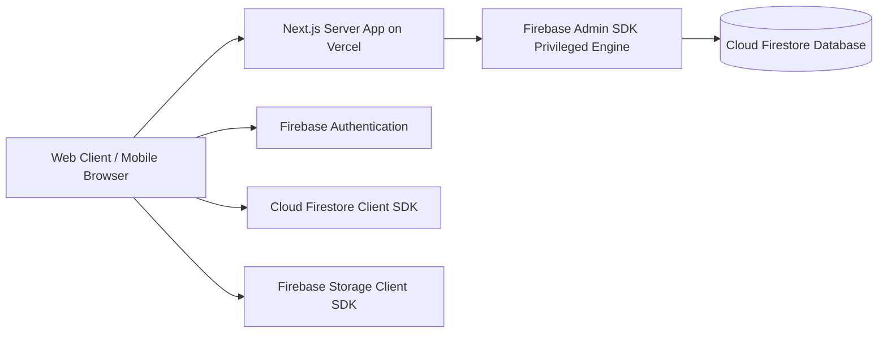

# THENIJOBS — Firebase Security, Database Architecture & Deployment Guide

**Firebase Project ID:** `thenijobs-9f01d`  
**Project Number:** `1057136000588`  
**Hosting Architecture:** Vercel Full Server Next.js 16.3.4 Application with Firebase Cloud Backend  
**Security Status:** Production Hardened & Verified  

---

## 1. Firebase Service Architecture

THENIJOBS leverages Google Firebase for real-time data persistence, media storage, and client identity, while running Next.js API routes and server tasks in a Vercel server environment.



---

## 2. Cloud Firestore Access Matrix (`firestore.rules` — 827 lines)

| Collection | Path Pattern | Read Access | Create / Update Access | Delete Access | Moderation / Invariant Rules |
|---|---|---|---|---|---|
| **Users** | `/users/{userId}` | Authenticated user (`isOwner(userId)`) or Admin | Owner cannot self-elevate `role` | Admin only | Immutable roles; privilege escalation blocked |
| **Seeker Profiles** | `/seekerProfiles/{userId}` | Public if `isPortfolioPublic == true` and not suspended; or Owner/Admin | Owner only (`isOwner(userId)`) | Owner / Admin | Resumes and phone numbers masked according to privacy settings |
| **Companies** | `/companies/{companyId}` | Public read for active and verified companies | Company Owner (`isCompanyOwner`) | Admin only | Moderation fields (`isActive`, `isVerified`, `isFeatured`, `subscriptionPlan`) immutable by owner |
| **Jobs** | `/jobs/{jobId}` | Public read for active, approved jobs within deadline | Company Owner (creates as `status: 'pending'` or `'draft'`) | Owner / Admin | Expired jobs hidden from public search; approved only by Admin |
| **Applications** | `/applications/{appId}` | Candidate (`applicantId`) or Employer (`companyId`) | Candidate creates; Employer updates status | Admin only | Status progression: `applied → shortlisted → interview_scheduled → selected / rejected` |
| **Leads** | `/leads/{leadId}` | Company Owner or Admin | Public creation (via website enquiry form) | Owner / Admin | Lead status workflow: `new → contacted → qualified → converted` |
| **Portfolio Sites** | `/portfolioSites/{siteId}` | Public read for active sites | Company Owner (plan-tier validated) or Seeker Owner | Admin / Owner | Template plan rank enforced against company's real `subscriptionPlan` |
| **Marketplace Items** | `/products/{id}`, `/services/{id}` | Public read for active items | Company Owner | Owner / Admin | Price, availability, and description validation |
| **Activity Logs** | `/activityLogs/{logId}` | Admin only | Privileged server / Admin SDK | Forbidden | Immutable append-only audit trail |
| **Platform Settings** | `/platformSettings/{docId}` | Public read for `public` config; Admin read for sensitive docs | Admin only | Forbidden | Governs maintenance mode and AI fallback configuration |

---

## 3. Firebase Cloud Storage Access Matrix (`storage.rules` — 119 lines)

| Storage Path | Content Type | Max Size | Read Access | Write Access |
|---|---|---|---|---|
| `resumes/{uid}/{filename}` | `application/pdf` | 5 MB | Resume Owner (`isOwner(uid)`) & Authenticated Employers | Resume Owner (`isOwner(uid)`) |
| `companies/{companyId}/logo/*` | Images (`image/*`) | 5 MB | Public read | Verified Company Owner |
| `companies/{companyId}/banners/*`| Images (`image/*`) | 10 MB | Public read | Verified Company Owner |
| `companies/{companyId}/gallery/*`| Images (`image/*`) | 10 MB | Public read | Verified Company Owner |
| `companies/{companyId}/products/*`| Images (`image/*`) | 5 MB | Public read | Verified Company Owner |
| `avatars/{uid}/*` | Images (`image/*`) | 2 MB | Public read | Account Owner |
| `websites/{siteId}/*` | Images (`image/*`) | 10 MB | Public read | Website Owner |

---

## 4. Firestore Composite Indexes

The project contains 46 active composite indexes defined in `firestore.indexes.json` to power high-speed multi-field queries:
- `jobs` collection: `status` + `category` + `createdAt DESC`
- `jobs` collection: `status` + `location` + `salaryMin DESC`
- `applications` collection: `companyId` + `status` + `appliedAt DESC`
- `applications` collection: `seekerId` + `appliedAt DESC`
- `leads` collection: `companyId` + `status` + `createdAt DESC`
- `referrals` collection: `ambassadorId` + `status` + `createdAt DESC`

---

## 5. Deployment Verification & Status

On October 23, 2026, Firebase rules and indexes were compiled and deployed directly to project `thenijobs-9f01d`:

```text
=== Deploying to 'thenijobs-9f01d'...
i  deploying firestore
+  cloud.firestore: rules file firestore.rules compiled successfully
+  firestore: deployed indexes in firestore.indexes.json successfully for (default) database
+  firestore: released rules firestore.rules to cloud.firestore
+  Deploy complete!

=== Deploying to 'thenijobs-9f01d'...
i  deploying storage
+  firebase.storage: rules file storage.rules compiled successfully
+  storage: released rules storage.rules to firebase.storage
+  Deploy complete!
```

---

## 6. Safe Rollback Procedure

If a previous version of Firestore or Storage rules needs to be restored:
1. View rules release history in Firebase Console:
   `https://console.firebase.google.com/project/thenijobs-9f01d/firestore/rules`
2. Select previous release timestamp and click **Revert**.
3. In local repository, check out the previous commit:
   ```bash
   git checkout HEAD~1 -- firestore.rules storage.rules
   firebase deploy --only firestore:rules,storage:rules
   ```
