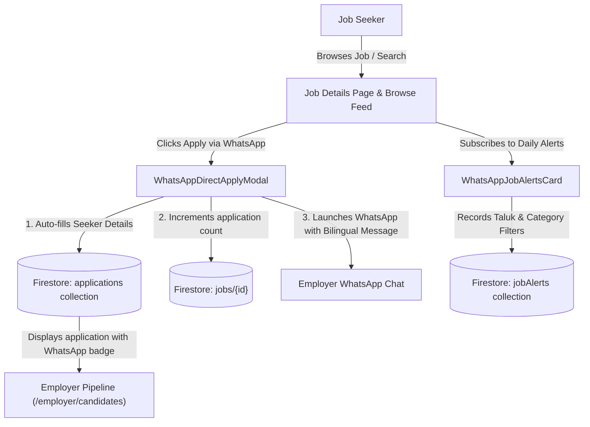

# THENIJOBS — 1-Click WhatsApp Direct Apply & Taluk Job Alerts

## Production Implementation & Verification Report

### 1. Executive Summary

This feature establishes **1-Click WhatsApp Direct Apply** and **Taluk-based WhatsApp Job Alerts** for job seekers across Theni District, bridging local candidate communication with structured platform tracking in Firestore and the Employer Pipeline.

---

### 2. Implemented Features & Architecture



#### 2.1 1-Click WhatsApp Direct Apply Modal
- **Component**: `src/components/jobs/WhatsAppDirectApplyModal.tsx`
- **Modal Input & Pre-fill**:
  - Automatically loads candidate name, phone number, qualification, experience, and home taluk from `seekerProfiles` / user auth.
  - Generates a polite bilingual Tamil + English message containing:
    - Target job role & company name
    - Candidate name, phone, qualification, experience, and taluk
    - Public candidate digital portfolio link (`https://thenijobs.com/portfolio/seeker/{uid}`)
- **Data Integrity & Tracking**:
  - Writes record to Firestore `applications` collection with `appliedVia: 'whatsapp'`, capturing candidate details so employers and admins retain full applicant counts and funnel metrics.
  - Automatically increments `jobs/{id}.applicationsCount` via Firestore `increment(1)`.
  - Opens direct WhatsApp conversation via `https://wa.me/{sanitizedPhone}?text={encoded}`.

#### 2.2 Taluk-Based WhatsApp Job Alerts
- **Component**: `src/components/jobs/WhatsAppJobAlertsCard.tsx`
- **Interactive Capabilities**:
  - Multi-select pill filters across all 7 Theni Taluks (`Theni`, `Periyakulam`, `Cumbum`, `Chinnamanur`, `Bodinayakanur`, `Andipatti`, `Uthamapalayam`).
  - Sector filter covering 9 popular local employment categories (Accounts & Tally, Retail Sales, Office Admin, Software & IT, Hospital, etc.).
  - 10-digit mobile number validation and sanitization.
  - Writes to Firestore `jobAlerts` collection with `active: true` and `frequency: 'instant'`.
- **Placement**:
  - Public job browse feed: `src/components/jobs/JobsBrowseContent.tsx`
  - Public job detail pages: `src/app/jobs/[id]/JobDetailPageClient.tsx`
  - Job Seeker dashboard: `src/app/seeker/dashboard/page.tsx`

#### 2.3 Employer Pipeline Presentation & Badging
- **Page**: `src/app/employer/candidates/page.tsx`
- **Enhancements**:
  - Identifies candidates who applied via WhatsApp with a prominent emerald `WhatsApp Apply` badge.
  - `CandidateDetailModal` displays `Applied via WhatsApp` banner, with direct fallback to candidate phone and taluk stored during WhatsApp application.
  - Preserves 7-day overdue SLA monitoring for WhatsApp applicants.

---

### 3. Verification & Automated Test Results

#### 3.1 Dedicated Test Suite
- **Test File**: `tests/whatsapp-apply-and-alerts.test.mjs`
- **Test Results**: 17 / 17 tests passed (0 failures).

```
▶ THENIJOBS — 1-Click WhatsApp Direct Apply & Job Alerts Test Suite
  ▶ WhatsApp Phone Number Sanitization (6 tests) - PASS
  ▶ Theni Taluks & Job Categories Reference Data (4 tests) - PASS
  ▶ Bilingual WhatsApp Direct Apply Message Builder (3 tests) - PASS
  ▶ Firestore Document Payload Schemas (2 tests) - PASS
  ▶ Employer Pipeline Presentation & Badging (2 tests) - PASS
✔ 17 passed, 0 failed (8.95ms)
```

#### 3.2 Full Project Regression Gates
- **Complete Test Suite**: `npm test` -> **246 passed across 50 test suites, 0 failed**.
- **TypeScript Check**: `npx tsc --noEmit` -> **Exit code 0 (0 compilation errors)**.
- **ESLint Check**: `npx eslint --quiet` -> **Exit code 0 (0 lint errors)**.
- **Git Deployment**: Pushed commit `b6e3c90` to `origin/main` (`https://github.com/SRIESWARAN01/thenijobs-web.git`).
